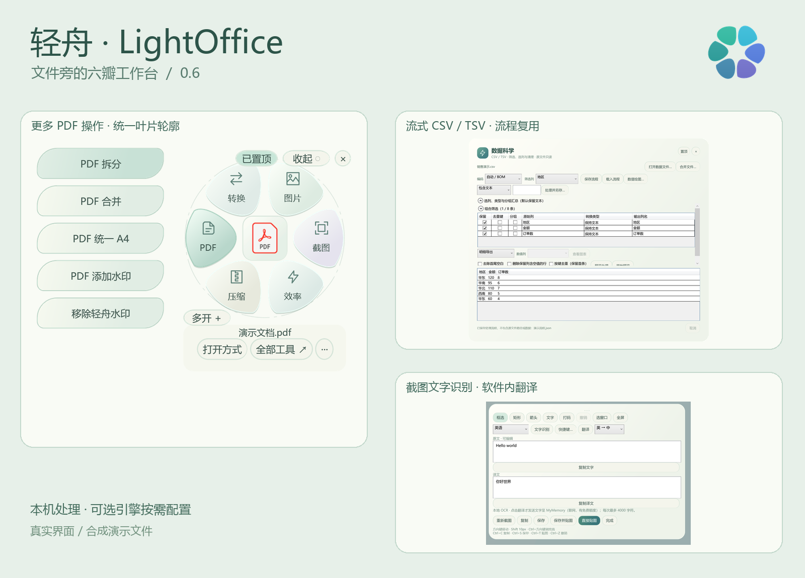
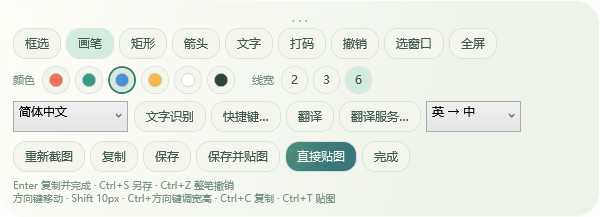
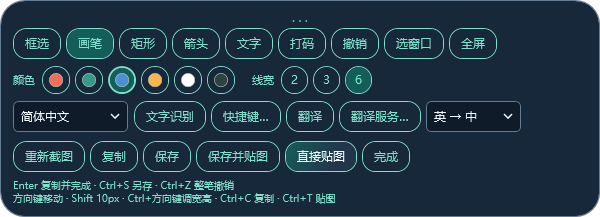
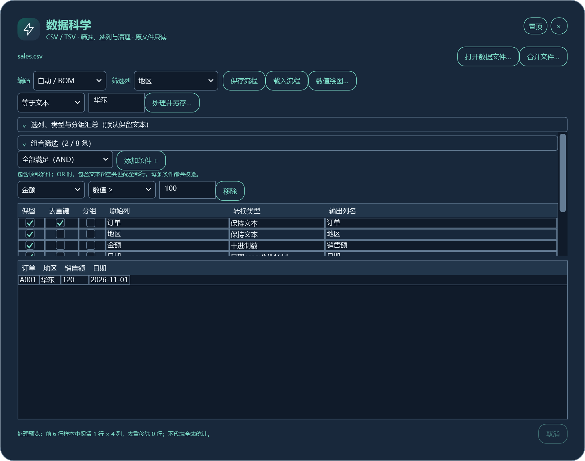
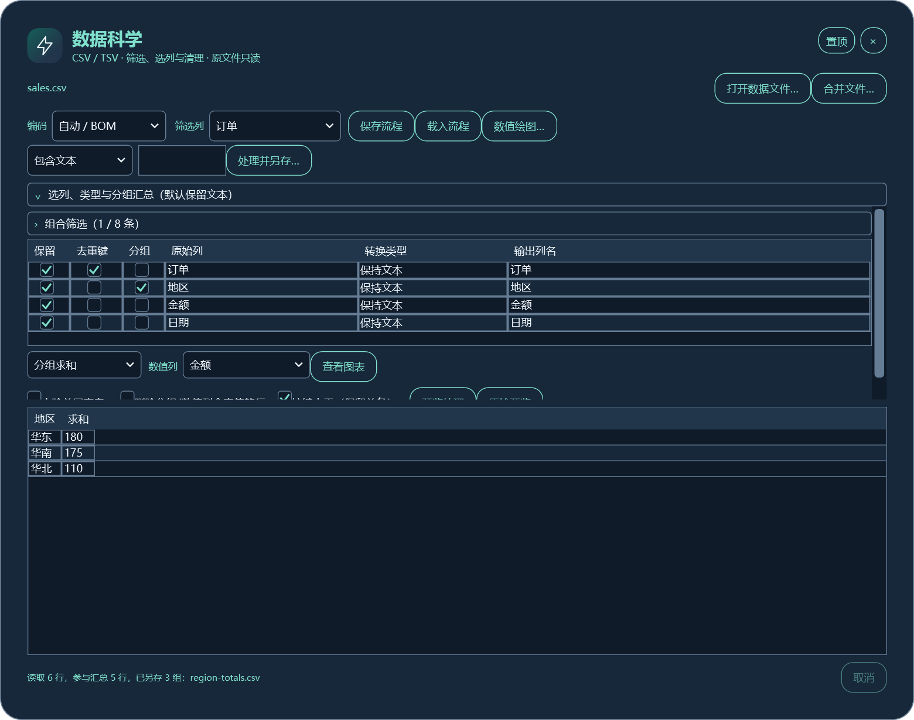

<div align="center">


# LightOffice · 轻舟

**Select a file. Keep everyday tools close at hand.**

Images · PDF · Screenshots, OCR and translation · Archives · CSV data science

[简体中文](README.md) · **English**

[](https://github.com/mengqy2022/LightOffice-Public/releases/latest)
[](docs/installation.md)
[](docs/faq.md)
[](https://github.com/mengqy2022/LightOffice-Public/releases)

[**Download installer**](https://github.com/mengqy2022/LightOffice-Public/releases/download/v0.7.4/LightOffice-0.7.4.0-Setup.exe) · [Portable ZIP](https://github.com/mengqy2022/LightOffice-Public/releases/download/v0.7.4/LightOffice-0.7.4.0-windows.zip) · [All features](docs/catalog.md) · [Screenshot gallery](screenshots/README.md) · [Report an issue](https://github.com/mengqy2022/LightOffice-Public/issues/new/choose)



</div>

LightOffice is a Windows tray utility built with C# and WPF. Select a file to reveal a flower menu with relevant actions. Tool windows can move independently, close and stay on top while you continue working with other files.

**Current release: 0.7.4.0.** This is the English product overview. The application interface, installer and detailed guides are currently in **Simplified Chinese**; switching README language does not change the application language. Links to detailed guides below lead to Chinese documentation.

The base package does not include LibreOffice, 7-Zip, Bandizip, Python or R. Configure optional engines only when needed. File processing runs locally; online translation sends text only when requested. This repository contains product documentation, synthetic examples, screenshots and binary releases. Development source code, tests and protection mappings are not published here.

## What's new in 0.7.4

- **Freehand screenshot pen:** six colors, 2 / 3 / 6 physical-pixel widths, whole-stroke undo and Esc to cancel the current stroke. Available in both themes, immediately after selection mode.
- **Enter to copy and finish:** copy the selected image with annotations to the clipboard, close capture, then press Ctrl+V in a compatible chat or app. No screenshot file is required. Ctrl+S still opens Save As. Text editing keeps its normal Enter behavior; a failed copy keeps your selection and annotations.
- **Small-screen handling:** window limits follow the usable work area and DPI. Below the design minimum, affected dialogs offer scrolling and restore their content layout on a larger screen.
- **Learning while using:** a four-step first-run guide, a real six-row CSV filtering/export exercise and compact, theme-aware shortcut suggestions that can be disabled.
- **Finish and close:** successful single-file rename and shortcut/translation configuration saves close their dialogs. Errors preserve the editor. Result workbenches stay available for review and repeated tasks.
- **Clearer PDF wording:** “Remove added watermark” applies only to watermarks added by LightOffice that retain its recovery marker.
- **About and feedback:** actual running version, developer Mengqy, development platform Codex, blog and email.

| Classic pen toolbar | Circular pen toolbar |
|---|---|
|  |  |

These are actual WPF controls rendered offscreen with synthetic content. They are not recordings of physical mouse input. [Release notes](docs/changelog.md) · [Validation scope](docs/validation.md)

## 24 tools in six categories

| Category | Tools |
|---|---|
| Conversion | [Image format conversion](docs/features.md#image-convert) · [Office documents to PDF](docs/features.md#document-convert) |
| Images | [Resize](docs/features.md#resize) · [Crop and rotate](docs/features.md#crop) · [Batch image processing](docs/features.md#image-batch) · [Image/PDF watermark](docs/features.md#watermark) |
| PDF | [Split](docs/features.md#pdf-split) · [Merge](docs/features.md#pdf-merge) · [Fit pages proportionally to A4](docs/features.md#pdf-a4) · [Add watermark](docs/features.md#pdf-watermark) · [Remove added watermark](docs/features.md#pdf-remove-watermark) |
| Capture | [Screenshots, annotation, OCR and translation](docs/features.md#capture) · [Pin image to desktop](docs/features.md#pin-image) |
| Archives | [Compress](docs/features.md#compress) · [Extract](docs/features.md#extract) · [Preview ZIP](docs/features.md#zip-preview) |
| Productivity | [Open file](docs/features.md#open) · [Open with](docs/features.md#open-with) · [Locate file](docs/features.md#locate) · [Copy path](docs/features.md#copy-path) · [Rename](docs/features.md#rename) · [Batch rename](docs/features.md#rename-batch) · [Preview text](docs/features.md#text-preview) · [Data science](docs/features.md#data-science) |

### CSV data science without a separate language runtime

Preview and process CSV/TSV with filters, AND/OR conditions, column selection and renaming, five type conversions, whitespace cleanup, duplicate handling, five grouped aggregations, file append and reusable recipes. Output is written to a new file. Bar charts, category line charts, histograms and scatterplots export to PNG using C#; Python and R are not required.

Preview and numerical plots use explicit budgets or samples. They do not imply unlimited data capacity. **XLSX structured editing and fast import of 500 MB–2 GB Excel workbooks are not supported.** DuckDB remains a separate technical experiment, not an integrated workbench engine.

| Combined filters | Grouped output |
|---|---|
|  |  |

Try [sales.csv](examples/sales.csv), the [saved recipe](examples/east-over-100.json), [cleaned output](examples/cleaned.csv) and [group totals](examples/region-totals.csv). [Data guide](docs/data-science.md) · [Reproducible examples](examples/README.md)

### Capture, annotate, copy, recognize and translate

Default capture shortcut: **Ctrl+Alt+S**. Select a region, a visible window rectangle or the current screen. Add freehand ink, rectangles, arrows, text or mosaic, then copy, save or pin the result. Enter copies and closes; it does not send a message to another person. Paste with Ctrl+V in your chosen app.

OCR uses installed Windows language capabilities and runs locally. The screenshot workbench displays editable recognized text and in-app Chinese/English translation. MyMemory is the default online service; a compatible LibreTranslate endpoint can be configured. Translation sends text rather than the screenshot, needs a network connection and is subject to service limits. It is not an offline translation model.

| Key | Action inside capture |
|---|---|
| Enter | Copy annotated image and close; no image file created |
| Ctrl+C | Copy image and keep editing |
| Ctrl+S | Save As PNG |
| Ctrl+Z | Undo the last annotation or complete pen stroke |
| Ctrl+T | Pin the current selection |
| Ctrl+Shift+O / Ctrl+Shift+T | OCR / translate; configurable |
| Esc | Cancel current stroke or adjustment; otherwise finish capture |

When editing text or selecting a language, Enter keeps its normal control behavior. [Capture guide and privacy](docs/capture.md)

### Files, themes and optional engines

Keep the light Classic theme or choose the dark Circular theme; workbenches follow the theme while images, ink colors and chart exports retain their colors. The flower menu offers three sizes, compact mode, collapse, multiple file contexts and topmost controls.

Office-to-PDF conversion can use configured Microsoft Office or LibreOffice. Enhanced archives depend on supported external engines. Optional engines are not bundled into the base download and are not required for unrelated tools. PDF A4 conversion preserves proportions; PDF watermark removal does not remove arbitrary third-party or scanned watermarks. Windows defaults remain separate from LightOffice's additional preferred applications.

## Install, verify and update

1. Download the **Setup EXE** or **portable ZIP** from [Releases](https://github.com/mengqy2022/LightOffice-Public/releases/latest), along with its `.sha256` file. GitHub's automatic “Source code” archives are not the application installer.
2. Check the SHA-256 value:

   ```powershell
   Get-FileHash -Algorithm SHA256 -LiteralPath .\LightOffice-0.7.4.0-Setup.exe
   Get-Content -LiteralPath .\LightOffice-0.7.4.0-Setup.exe.sha256
   ```

3. The Chinese installer provides a license, custom writable installation directory, options, progress and an independent `unins000.exe`. It installs for the current user without requesting administrator privileges. Uninstall from Windows Settings, the Start menu or the uninstaller.
4. For the portable package, extract the whole ZIP and keep its DLLs, configuration and licenses together. Run `LightOffice.exe`.
5. Save work and exit the older instance before updating. Different versions keep separate program directories. If your login startup path changes, disable the old registration and re-enable it from the version you intend to use.

Requires **Windows 10/11 and .NET Framework 4.8**. Login startup is off by default. Uninstall preserves settings, optional components and user-created output by default; the installer offers an explicit settings-removal choice. **The program and installer are currently unsigned.** Verify official downloads using their published hashes.

[Installation guide](docs/installation.md) · [Version and rollback guide](docs/versions.md) · [Download verification](releases/README.md)

## Documentation and evidence

| Need | Guide (Chinese) |
|---|---|
| First use and guided practice | [Quick start](docs/quickstart.md) · [Interactive learning](docs/getting-started.md) |
| Every tool and its limits | [Feature catalogue](docs/catalog.md) · [Detailed manual](docs/features.md) |
| Step-by-step tasks and expected output | [Six tutorials](docs/tutorials.md) · [Example files](examples/README.md) |
| Themes, windows, file associations and rename | [Desktop guide](docs/desktop.md) |
| Optional engines | [Components](docs/components.md) |
| Errors and known limits | [Troubleshooting](docs/troubleshooting.md) · [FAQ](docs/faq.md) |
| Measurements, privacy and tests | [Performance scope](docs/performance.md) · [Privacy](docs/privacy.md) · [Validation](docs/validation.md) |
| All feature images | [Screenshot gallery](screenshots/README.md) |

The release uses the tested protected executable. Its pen/Enter/layout suite passed 165 checks; an isolated installer built from the release ZIP passed 38 real install/uninstall checks with all 89 payload hashes matching. Targeted tests are recorded by build and scope. Offscreen rendering and simulated work-area matrices do not replace physical mouse or application-paste acceptance. Earlier builds have real dual-monitor DPI, Windows scaling, desktop capture and manual dialog checks; a short S0 modern-standby transition was observed. On 2026-11-12, the user confirmed that freehand drawing, whole-stroke undo, and pasting into a chat with Ctrl+V after Enter-to-copy all worked in their environment. This is user-reported acceptance, not a matrix of all themes, apps or DPI settings. Long sleep/hibernation and clean-machine combinations remain unverified. See the release's [validation notes](docs/validation.md).

## Developer, feedback and license

**Developer: Mengqy · Development platform: Codex · Product: LightOffice / 轻舟.**

[Blog and comments](https://www.mqymmb.com/posts/lightoffice/#license-note) · Email: **15877464851@163.com** · [GitHub issues](https://github.com/mengqy2022/LightOffice-Public/issues/new/choose)

Include the running version, Windows version, steps to reproduce and the error text. Remove private file contents, account details and local paths before sharing.

The current application and newly licensed materials use a [proprietary license](LICENSE), with free personal and internal business use under its terms. Earlier [MIT grants](LICENSE-LEGACY-MIT.txt) and third-party licenses remain applicable. The public repository is a product and release repository, not a publication of the development source. [License explanation](docs/licensing.md)
