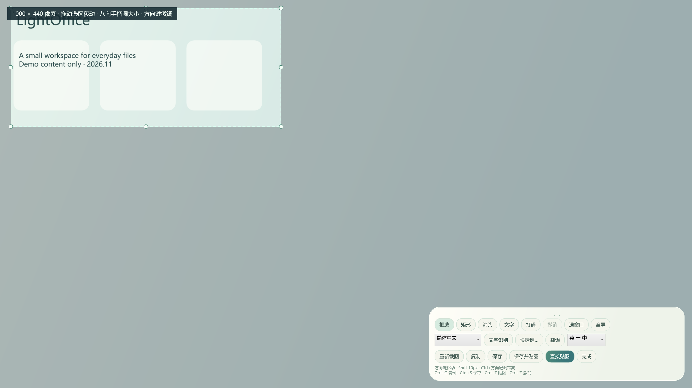
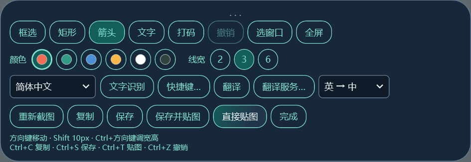
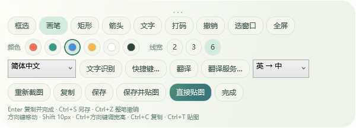
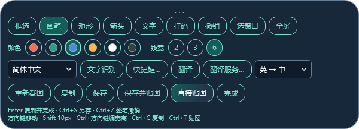
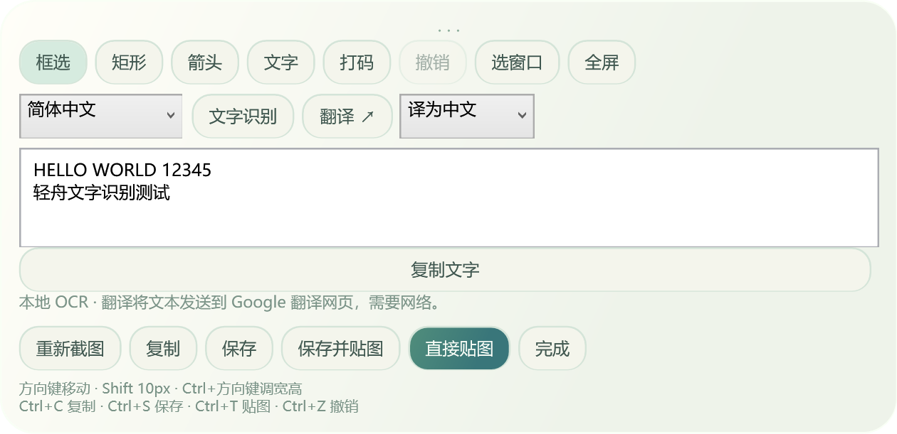
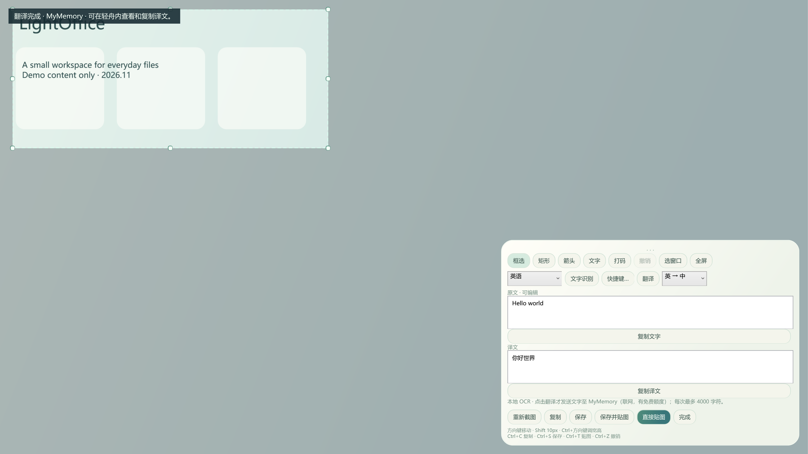
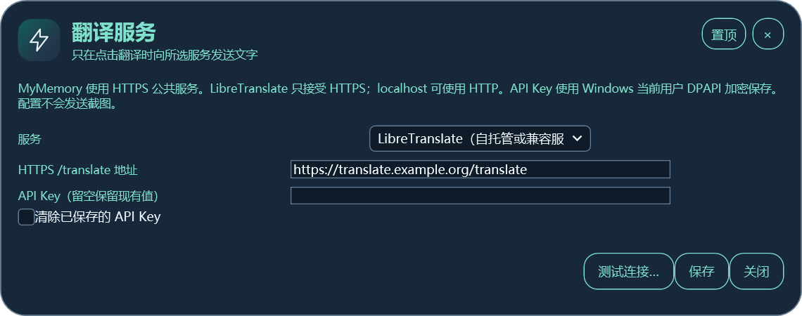
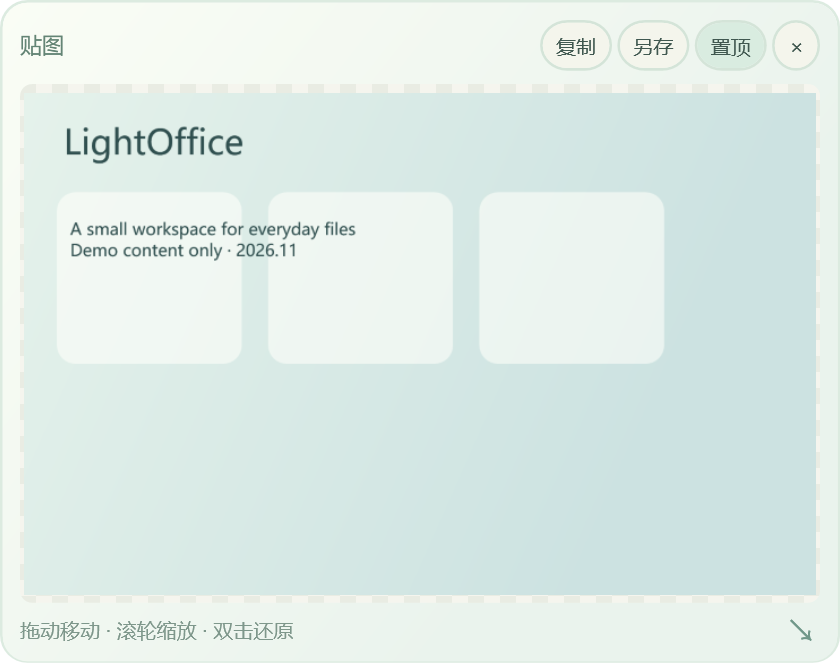
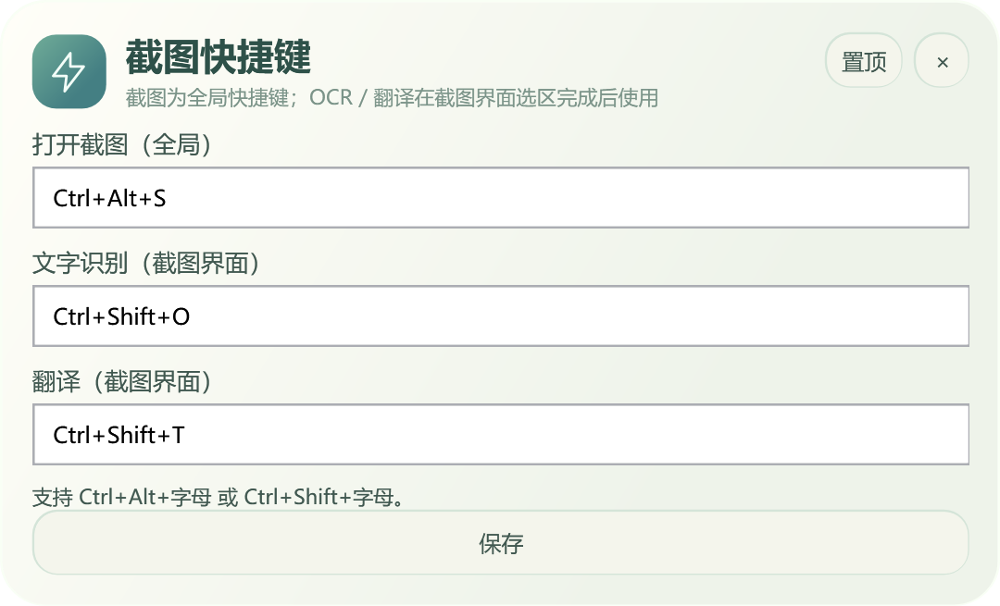

# 截图、标注、识别、翻译和桌面贴图

[全部功能](catalog.md) · [基础使用](usage.md) · [隐私与组件](components.md)

截图、OCR、GUI 内中英翻译在 0.6 正式版可用。深色工具栏、翻译服务配置图来自 0.7.2 正式版，下载以 [Releases](https://github.com/mengqy2022/LightOffice-Public/releases/latest) 为准。

## 截图和选区调整

使用 `Ctrl+Alt+S` 或「截图」入口开始。拖动框选、「选窗口」或「全屏」均可；选窗口取得当前屏幕快照中可见矩形，不会还原被其他窗口遮住的内容，跨屏窗口只取本次屏幕部分。

| 操作 | 方法 |
|---|---|
| 移动 / 调整选区 | 拖动选区或边角手柄 |
| 精细移动 | 方向键，按住 Shift 每次 10 px |
| 精细调整宽高 | Ctrl + 方向键；可加 Shift |
| 重新取画面 | 点击「重新截图」 |
| 结束 | 「完成」或 Esc；翻译中 Esc 先取消翻译 |

## 标注、色板、线宽和文字

0.7.4新增自由画笔，位于工具栏第一行「框选」右侧，经典与圆弧主题均提供。框选后点「画笔」，在选区内按住鼠标绘制；支持六种颜色与 2 / 3 / 6 px 粗细。`Ctrl+Z` 或「撤销」会撤掉完整一笔，绘制中按 Esc 只取消当前一笔。

矩形、箭头、文字和打码继续在选区中使用。矩形和箭头也可选择颜色与线宽；文字可以输入内容并选择字号。打码用于遮盖画面信息，分享前仍应检查实际导出结果。

这张工具栏细节图由真实控件离屏渲染，使用合成选区；没有截取私人桌面。色板保留原色，不跟随深色主题改变。

| 经典画笔 | 圆弧画笔 |
|---|---|
|  |  |

以上两图为 0.7.4 真实控件的离屏渲染。小屏会换行、纵向滚动；画笔与 Enter 说明随主题适配。

## 本地 OCR

选择简体中文、英语或系统首选语言，点击「文字识别」。识别需要对应 Windows OCR 语言能力已经安装，截图不上传到翻译服务。

结果可编辑、复制。修改选区或标注后旧结果清空；清晰度、字体和语言都会影响准确率。超过系统 OCR 尺寸范围时请缩小选区。

## GUI 内翻译与服务设置

选择「英 → 中」或「中 → 英」后点「翻译」。没有原文时先执行识别；原文和译文直接显示在轻舟内，支持复制译文和取消，不跳转网页。

默认 MyMemory；0.7.2 的「翻译服务…」还支持配置 LibreTranslate 自托管或兼容服务。

图中的 `https://translate.example.org/translate` 为示例地址，不能作为现成服务使用。「测试连接…」会主动向所选服务发送测试文字 Hello；「保存」只保存配置。兼容接口必须使用 HTTPS 的 `/translate` 地址，只有 localhost 可用 HTTP。API Key 在当前 Windows 用户下使用 DPAPI 加密保存，留空保留旧值，勾选可清除。

翻译时只发送结果框中的文字，不发送截图；每次最多 4000 字符，自动分段，有超时、额度与网络失败提示。失败保留原文。当前仍是中英方向，没有内置离线模型，也不会因为填写新服务地址而自动支持所有语言。

## 输出与桌面贴图

| 输出 | 使用方法 | 是否产生文件 |
|---|---|---|
| 复制并完成（0.7.4） | Enter；复制包含标注的当前图片并关闭截图框，再在 APP 中按 Ctrl+V | 只写图片剪贴板，无需保存文件 |
| 复制 | 「复制」或 Ctrl+C | 写入图片剪贴板 |
| 保存 | 「保存」或 Ctrl+S | 新 PNG |
| 保存并贴图 | 点击同名按钮 | 新 PNG + 桌面贴图 |
| 直接贴图 | 同名按钮或 Ctrl+T | 暂不保存文件，关闭前可另存 |
| 贴已有图片 | 「桌面贴图」工具选择 PNG / JPG / BMP | 不改写原图 |

Enter 不会自动向聊天对象发送图片。输入文字标注、编辑 OCR / 译文、选择语言以及笔画尚未完成时，Enter 不触发复制完成。复制失败保留截图框和标注，可以重试；Ctrl+S 仍打开另存对话框。

贴图可拖动、滚轮缩放、拖动右下角改变大小、双击还原显示尺寸。复制和另存均使用原图片内容，窗口缩放不等于改写图片像素。关闭未保存的直接贴图会释放内容，需要保留时请先另存。

## 快捷键

默认截图 `Ctrl+Alt+S`、识别 `Ctrl+Shift+O`、翻译 `Ctrl+Shift+T`。在托盘或工具栏「快捷键…」配置，重复设置或系统注册冲突会提示。

截图交互有 1600 万像素预算。以上图片展示界面与入口；本轮新增图没有访问网络或重新验证 OCR 准确率，历史验证见[验证说明](validation.md)。
