# 轻量基础包、可选组件和文件输出

[功能导航](catalog.md) · [下载与校验](../releases/README.md) · [常见问题](faq.md)

基础包使用 Windows 系统 .NET Framework 4.8；图片、内置 PDF 处理、ZIP、数据处理和 C# 绘图不要求 Microsoft Office、浏览器、Python 或 R。大组件根据需求配置，包体大小与任务运行内存分别看待。

## 需要什么组件

| 功能 | 基础能力 | 可选组件与作用 |
|---|---|---|
| 图片处理 | PNG / JPG / BMP，尺寸、裁剪、旋转、水印、批处理 | 无需额外引擎 |
| PDF 拆分 / 合并 / A4 / 轻舟水印 | 内置处理静态未加密 PDF | 不要求 Office |
| PDF 真实首页水印预览 | 0.7 系列优先尝试 Windows PDF 缩略图处理器 | 可配置已有 MuPDF `mutool.exe` |
| DOCX / XLSX / PPTX 转 PDF | 需要办公转换引擎 | LibreOffice 或本机 Microsoft Office |
| ZIP 预览、压缩和安全解压 | 内置 | 无需外部软件 |
| 7z 压缩，普通 7z / RAR 解压 | 可选增强 | 已有 7-Zip；不创建 RAR |
| ZIP 压缩增强 | 可选增强 | 已有 Bandizip；线程效果取决于格式及引擎 |
| 本地 OCR | Windows OCR 能力 | 对应 Windows 语言包 |
| 中英翻译 | MyMemory 网络服务 | 0.7 系列可配置 LibreTranslate 兼容服务 |
| CSV / TSV、流程、四类图表 | 内置逐记录处理与 C# 绘制 | 不需要 Excel、Python、R 或 DuckDB |

## 组件管理

从托盘进入「可选组件」。选择已有程序、恢复自动检测、停用 / 启用、刷新检测、导入配套离线 ZIP、查看占用和移除自管组件都在这里。

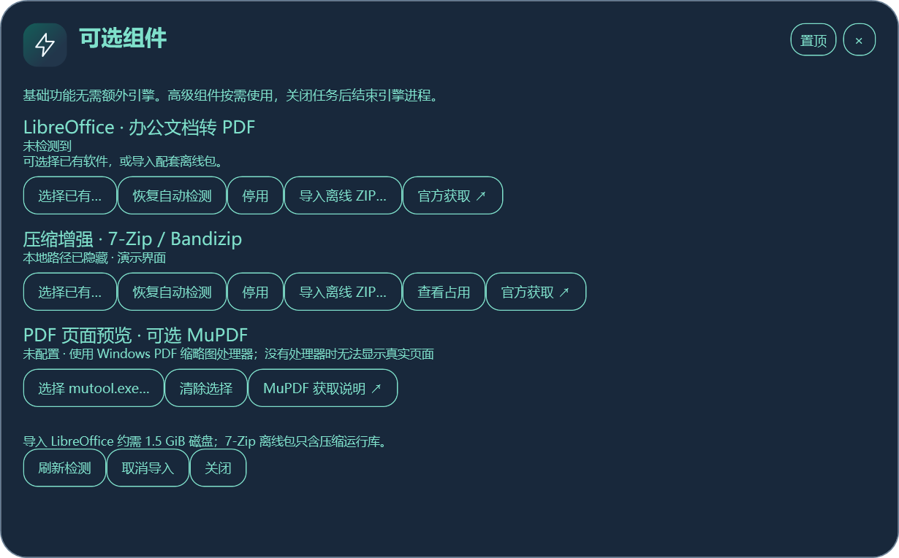

「导入离线 ZIP」要求配套组件包结构，不表示可把任意官方安装 EXE 或 MSI 改成 ZIP 导入。LibreOffice 自管副本约需 1.5 GiB 磁盘；磁盘占用不是常驻内存。取消导入会清理未完成内容，移除仅针对轻舟管理的组件目录，不卸载用户原有办公软件。

基础包不分发 LibreOffice、7-Zip、Bandizip、MuPDF 或翻译模型。组件版本和许可由对应项目规定，正式下载及校验以其官方来源为准。

## 图片与办公转换

| 操作 | 能设置什么 | 输出 |
|---|---|---|
| 图片尺寸 | 宽高、锁定比例、25 / 50 / 100% 预设 | 新图片；保留相应格式 |
| 格式转换 | PNG / JPG / BMP，JPG 质量 | 新文件；注意 JPG 无透明通道 |
| 裁剪与旋转 | 拖框或像素坐标、比例预设、90°旋转 | 新图片 |
| 图片批处理 | 添加 / 拖入多图，等比缩小、统一格式 | 逐张另存，已完成结果保留 |
| 图片文字水印 | 文字、左上 / 居中 / 右下、透明度、字号比例 | PNG，可批量另存 |
| 办公文档转 PDF | 选择文件、引擎和输出位置 | 新 PDF，需人工复核字体与分页 |

| 尺寸调整 | 批处理 |
|---|---|
| 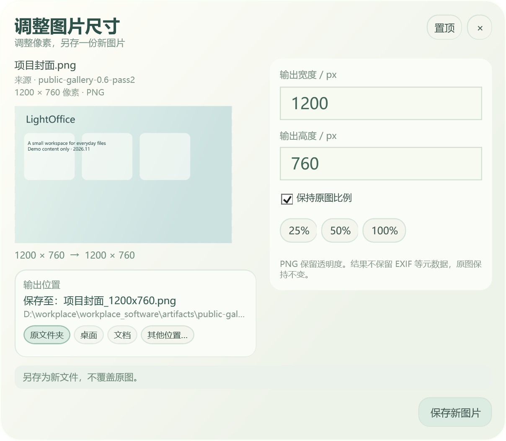 | 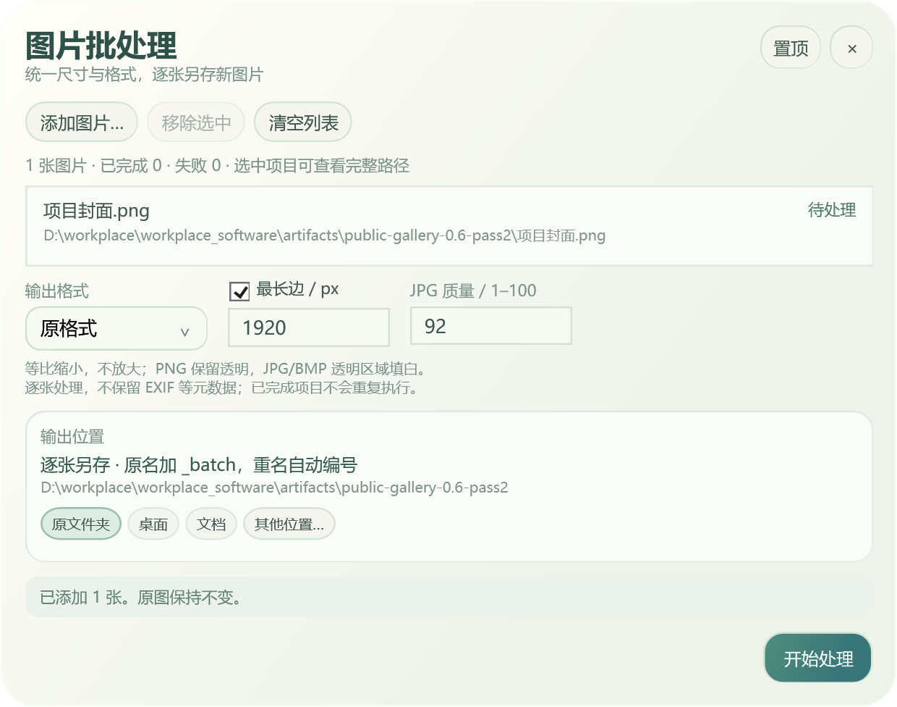 |

| 裁剪旋转 | 文档转 PDF |
|---|---|
| 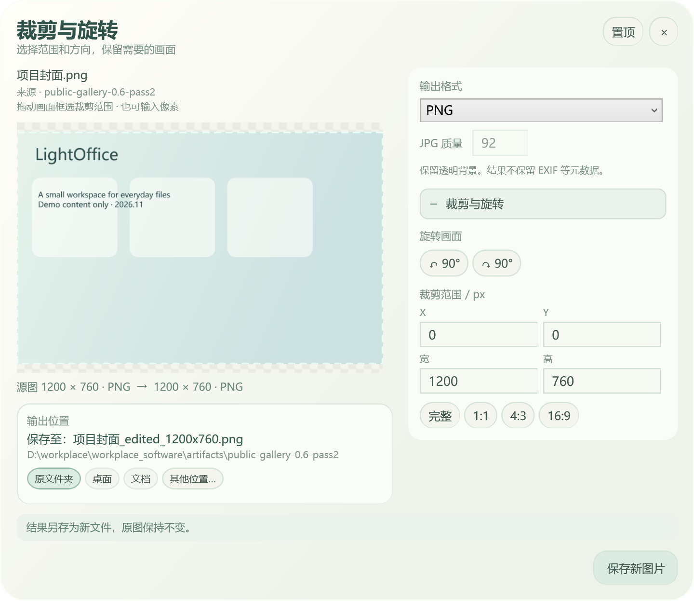 | 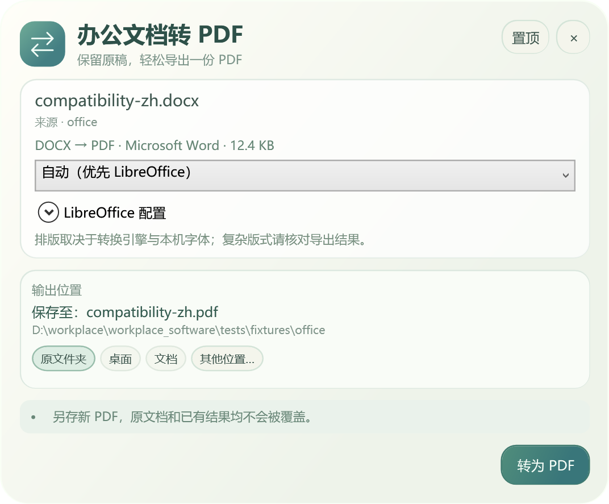 |

## PDF：A4、顺序、水印

「PDF 统一 A4」先检查每页尺寸，显示 A4 / 非 A4 数量；横纵向分别适配 A4，等比例缩放并居中，必要时留白，不拉伸内容。已全部是 A4 时提示无需生成；容差与不支持输入会明确说明。

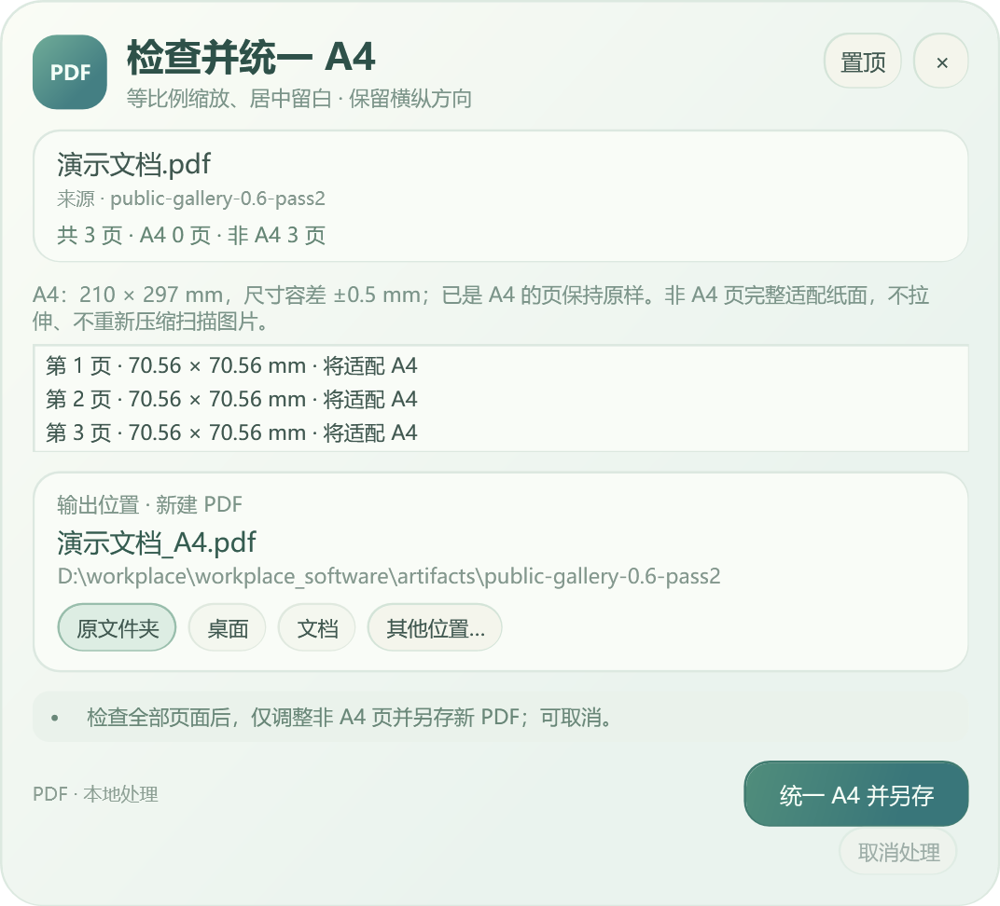

拆分支持单页、范围和组合页面选择；合并按列表顺序，可调整文件先后。输出始终为新 PDF。

| 拆分 | 合并顺序 |
|---|---|
| 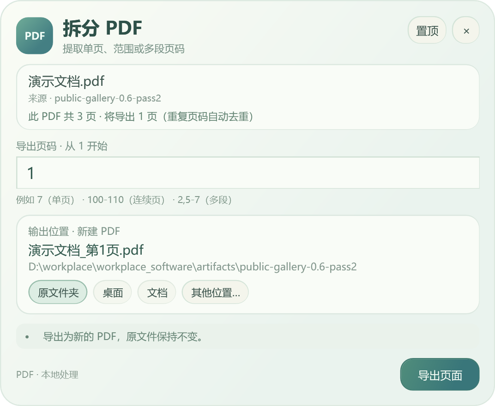 | 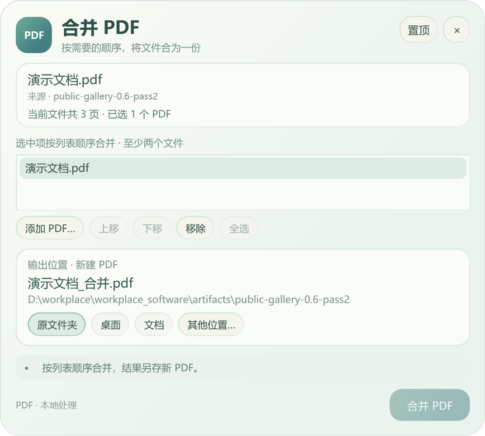 |

文字水印支持预览和批量另存。0.6 图只有位置示意；0.7 系列可读取真实首页，缺少 Windows 处理器时配置已有 MuPDF。预览失败会说明原因，不会把空白背景说成真实原页。「移除轻舟水印」仅恢复保留轻舟标记的页面，其他水印及扫描图水印不自动删除。

| 添加水印（0.6 位置示意图） | 移除轻舟标记水印 |
|---|---|
| 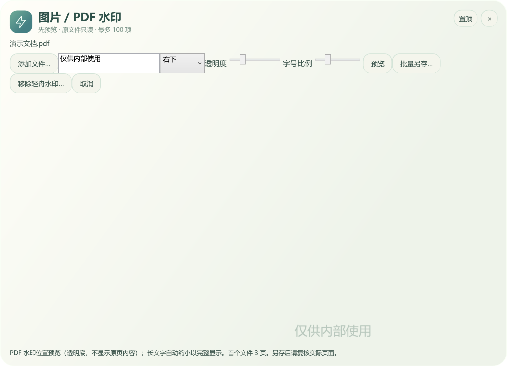 | 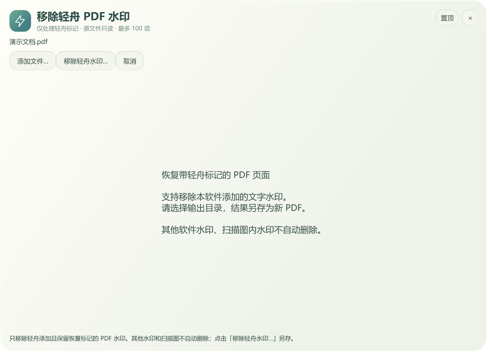 |

加密、签名、交互表单和特殊 PDF 结构并非全部支持，正式处理前保留源文件。普通办公转换不等于 XLSX 数据导入。

## 压缩、解压与安全另存

压缩可加入多个文件 / 文件夹，内置 ZIP 或选择已配置引擎；解压到新的输出目录。高级解压拒绝加密、分卷、链接、附加数据流及路径穿越，最多一万项、512 MiB 声明数据，避免压缩炸弹或写出目标目录。

| 多源压缩和增强选项 | 解压 |
|---|---|
| 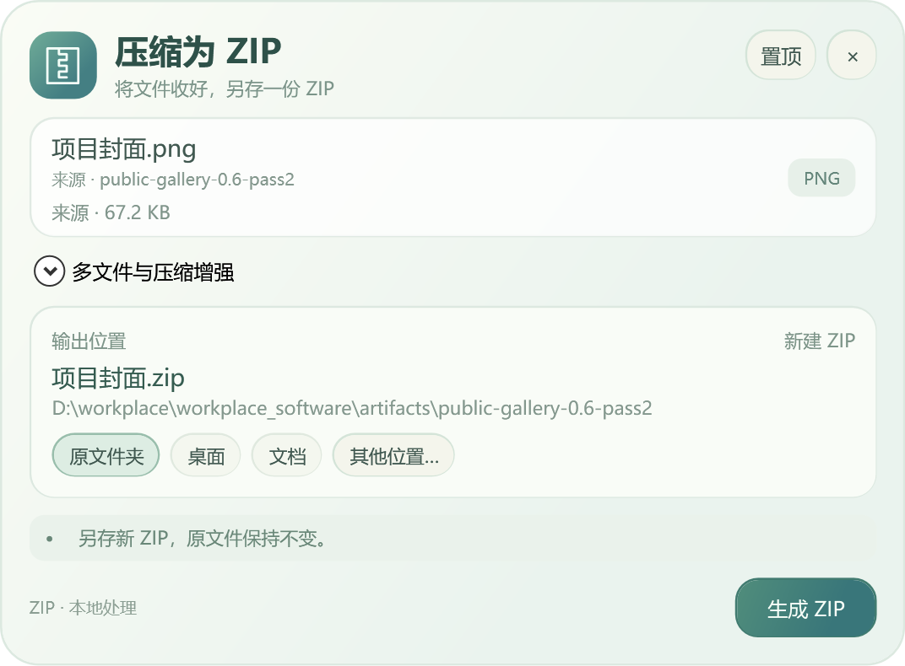 | 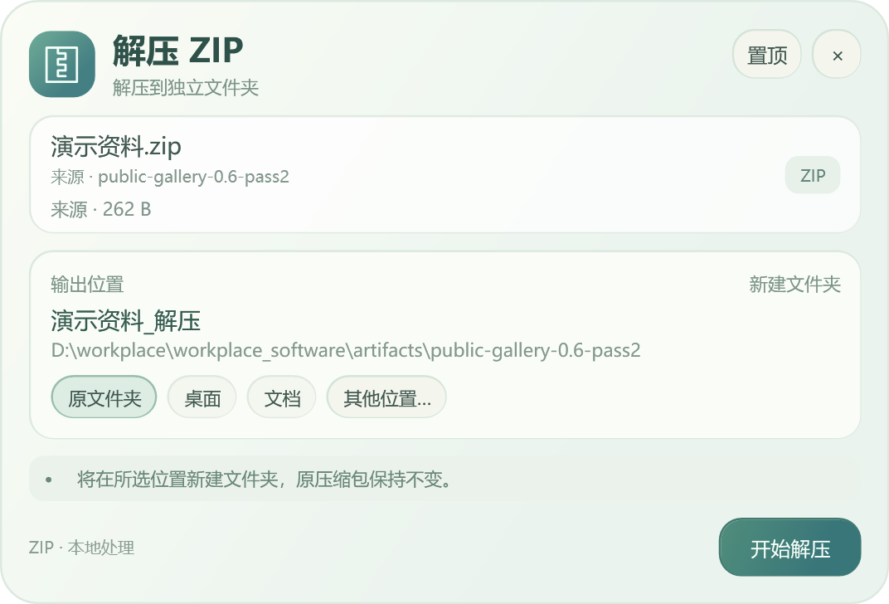 |

图片、PDF、数据和压缩结果以新文件 / 目录发布；已有目标不覆盖。输出位置面板可选原文件夹、桌面、文档或其他位置，成功后查看结果。单文件任务失败 / 取消不发布半成品；批量任务已经完成的独立文件可能保留，状态中会说明。

## 安装与卸载的版本差异

0.6 正式版需要按[使用说明](usage.md#更新与移除)手动移除。0.7 系列已增加「设置 → 应用」卸载入口、版本目录并存和旧版回退，现已随 0.7.2 正式发布。换目录前关闭旧版登录自启，退出程序后再切换；个人设置和已导出文件不随卸载自动删除。
