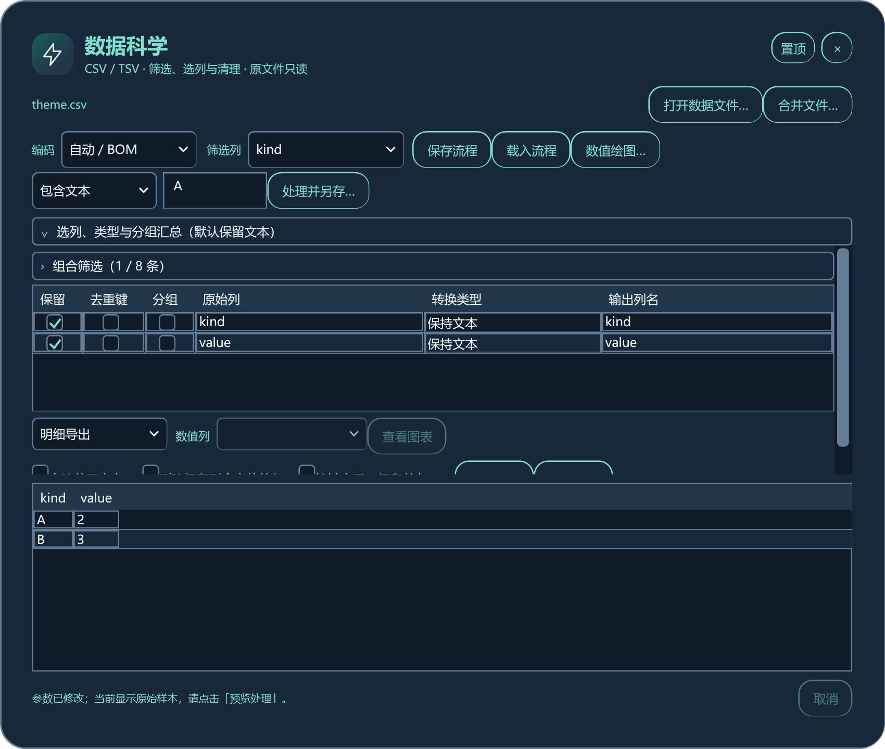
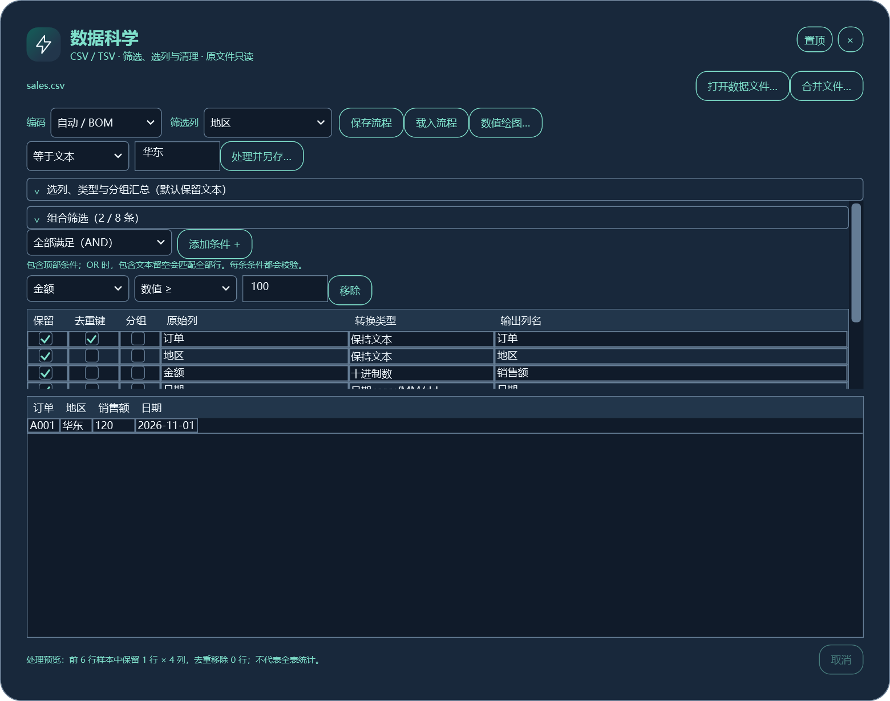
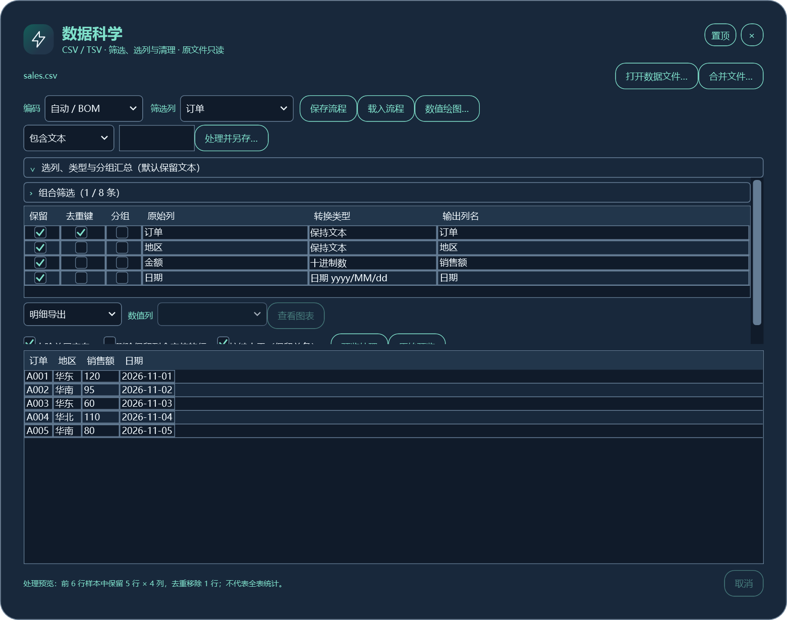
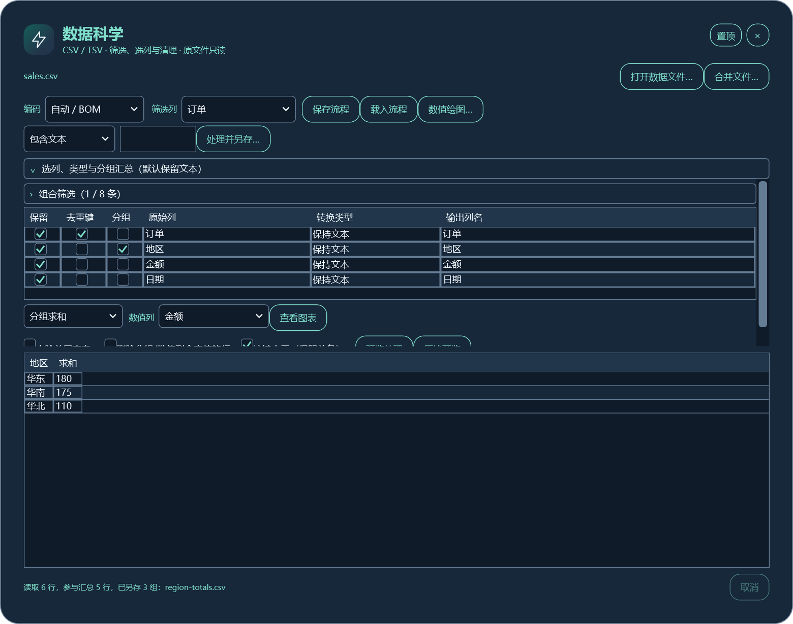
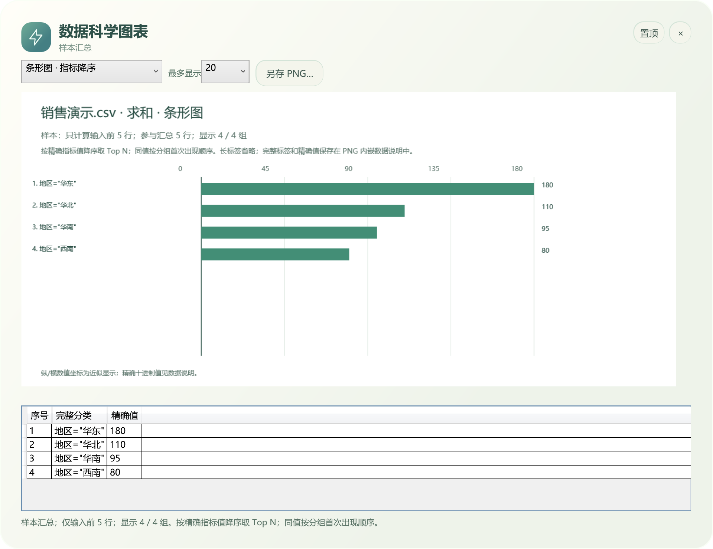
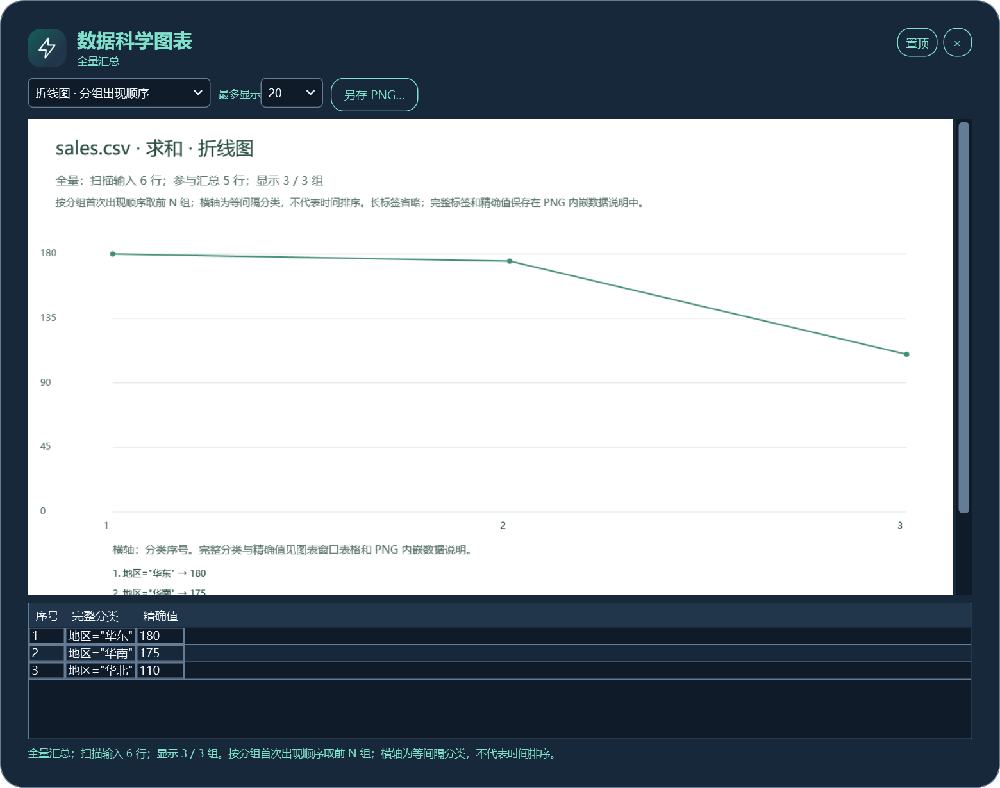
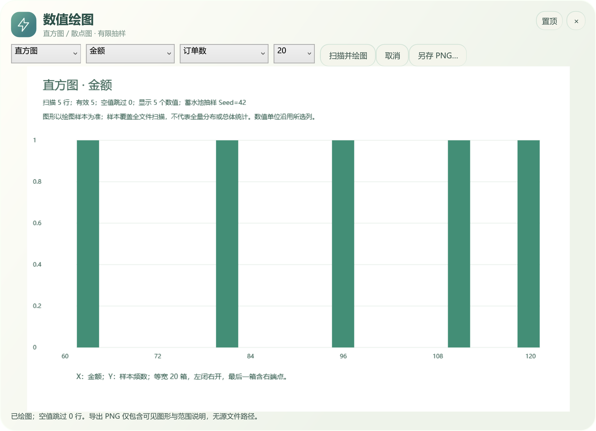
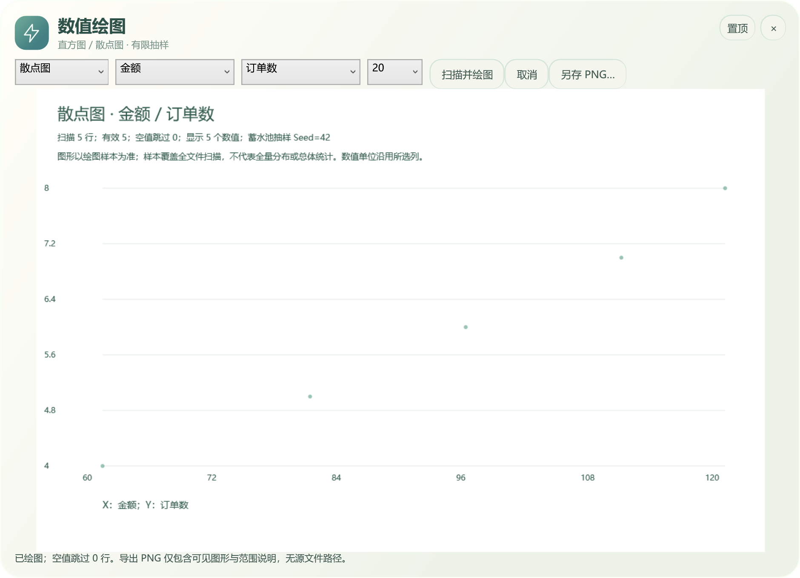

# 数据科学：从一份 CSV 到清理结果和图表

[功能导航](catalog.md) · [下载演示文件](../examples/README.md) · [全部工具](features.md)

适用：0.6 正式版已有数据处理和绘图；下列深色界面来自 0.7.2 正式版。当前公开下载以 [Releases](https://github.com/mengqy2022/LightOffice-Public/releases/latest) 为准。数据科学处理 CSV / TSV，无需 Excel、Python 或 R。

## 先认识工作台

从「效率 → 数据科学」或「全部工具」进入，打开或拖入 CSV / TSV。顶部选择编码、筛选列及条件，中间设置列、类型、清理和汇总，下方显示预览。「预览处理」试算有限样本，「处理并另存」读取全文件并写入新文件。

默认预览最多 200 条数据记录、512 列、2 Mi 字符。CSV 中带引号的换行属于同一记录，因此记录数未必等于文本物理行数。自动 / BOM、UTF-8、GB18030、Big5、UTF-16 LE、UTF-16 BE 可选；无 BOM 自动模式按 UTF-8 读取，乱码时请按原文件编码选择。

## 16 种筛选与组合条件

| 条件 | 输入示例 | 结果含义 |
|---|---|---|
| 包含文本 | 地区包含 `华` | 保留含该片段的文本；条件留空匹配全部 |
| 等于文本 | 地区等于 `华东` | 完整文本匹配 |
| 不包含文本 | 备注不包含 `测试` | 排除含该片段的文本 |
| 不等于文本 | 地区不等于 `华东` | 排除完整匹配 |
| 为空 | 无需输入 | 空字符串或纯空白 |
| 不为空 | 无需输入 | 保留非空值 |
| 数值 = | 金额 `100` | 精确十进制相等 |
| 数值 > | 金额 `100` | 大于 100 |
| 数值 ≥ | 金额 `100` | 大于或等于 100 |
| 数值 < | 金额 `100` | 小于 100 |
| 数值 ≤ | 金额 `100` | 小于或等于 100 |
| 数值区间 | 下限 `80`，上限 `120` | 包含两个端点 |
| 日期 = | `2026-11-01` | 同一天 |
| 日期早于 | `2026-11-04` | 严格早于该日期 |
| 日期晚于 | `2026-11-01` | 严格晚于该日期 |
| 日期区间 | `2026-11-01` 至 `2026-11-03` | 包含起止日期 |

文本筛选不区分大小写；数值条件使用点号小数，不接受千分位或科学计数法。日期条件填写 `yyyy-MM-dd`，源数据按选定列类型解析。非法非空数值或日期会报错，请先修正数据或类型。

展开「组合筛选」，点击「添加条件 +」可加入其他列条件。总计最多 8 条（包含顶部条件）；「全部满足（AND）」取交集，「任一满足（OR）」取并集。OR 中任何一个“包含文本且留空”的条件会匹配全部行。

本图使用[销售示例](../examples/sales.csv)：`地区 = 华东 AND 金额 ≥ 100`，真实预览结果只有订单 A001、金额 120。

## 选列、改列名、类型转换与清理

| 操作 | 位置与用法 | 需要注意 |
|---|---|---|
| 选列 | 勾选「保留」 | 不导出的列也可参与筛选或类型校验 |
| 输出列名 | 双击「输出列名」 | 空名或重复名称会被拒绝 |
| 保持文本 | 转换类型默认项 | 编号、电话、带前导零内容建议保留文本 |
| 十进制数 | 金额或数量列 | 精确十进制，非法非空值报记录位置 |
| 日期 yyyy-MM-dd | 如 `2026-11-01` | 输出统一为 `2026-11-01` |
| 日期 yyyy/MM/dd | 如 `2026/11/01` | 输出统一为 `2026-11-01` |
| 日期 yyyyMMdd | 如 `20261101` | 输出统一为 `2026-11-01` |
| 去除首尾空白 | 勾选清理项 | 去除值两端空白，不删除内部空格 |
| 删除保留列含空值的行 | 勾选清理项 | 任一相关列为空则删除；`NA`、`NULL` 文本不会自动当空值 |
| 按键去重（保留首条） | 勾选一列或多列「去重键」，再开启去重 | 按清理和转换后的键值精确匹配，区分大小写 |
| 原始预览 | 点击对应按钮 | 查看原始样本，不会撤销已经另存的文件 |

示例将「金额」改成「销售额」、日期按斜杠格式读取，并按「订单」去重。6 条输入中 A003 重复一次，输出 5 条。[查看真实导出 CSV](../examples/cleaned.csv)。

## 五种分组汇总

勾选一个或多个「分组」列，在「明细导出」下拉框选择汇总方法。计数不要求数值列，其他方法必须选择数值列。

| 方法 | 适用问题 | 示例 |
|---|---|---|
| 分组计数 | 每个地区有多少订单？ | 去重后华东 2、华南 2、华北 1 |
| 分组求和 | 各地区金额合计？ | 华东 180、华南 175、华北 110 |
| 分组平均值 | 各地区平均金额？ | 华东 90、华南 87.5、华北 110 |
| 分组最小值 | 各地区最小金额？ | 华东 60、华南 80、华北 110 |
| 分组最大值 | 各地区最大金额？ | 华东 120、华南 95、华北 110 |

这里先按订单去重，再按地区求和，实际[输出结果](../examples/region-totals.csv)可下载比对。只点「预览处理」时，汇总来自前 200 条样本；全文件另存成功后，图表窗口才可使用此次全量汇总。每次修改参数都会让旧图表结果失效。

## 四种绘图，不安装额外环境

| 图形 | 入口 | 数据范围与规则 |
|---|---|---|
| 条形图 | 分组汇总后「查看图表」 | 按指标降序，最多显示 10 / 20 / 50 组 |
| 分类折线图 | 同一窗口切换图形 | 按分组首次出现顺序，横轴等间隔分类，不代表连续时间 |
| 数值直方图 | 「数值绘图…」选择一列 | 扫描全文件后有限抽样，10 / 20 / 40 等宽箱，末箱包含最大值 |
| 数值散点图 | 「数值绘图…」选择 X、Y | 固定种子抽样，最多保留 1000 个有效数值对 |

| 条形图 | 分类折线图 |
|---|---|
|  |  |

| 数值直方图 | 数值散点图 |
|---|---|
|  |  |

图表可另存 PNG。汇总图的完整标签、精确值、参数和范围说明写入 PNG 数据说明；[示例导出](../examples/region-line.png)来自实际全文件汇总。数值图会标明扫描、有效、空值和样本数量，坐标为近似浮点数；直方图和散点图不能冒充全量分布统计。修改列、图形类型或分箱后需重新扫描，取消或失败后不导出旧图。

## 按行合并与流程复用

「合并文件…」可按列表顺序追加 2–100 份同表头同顺序的 CSV / TSV，输出只保留一个表头。这是按行追加，不是按键连接或自动对齐不同列。

「保存流程」记录编码、列结构、筛选、类型、清理、去重和分组设置；「载入流程」核对版本、列名顺序和当前编码后恢复设置。流程 JSON 不嵌入原文件路径或原始行，但条件、替换名称仍可能含业务信息。可以下载[实际保存并重新载入通过的流程](../examples/east-over-100.json)，配合销售示例使用。

## 规模与失败处理

预览有界、另存逐记录读取；这不等于进程内存恒定。唯一键最多 20 万、分组最多 10 万，两种状态各有约 32 MiB 估算预算；单字段最多 65536 字符、单记录最多 262144 字符。遇到预算超限、不合法数据、取消或目标被占用时停止，不发布部分数据文件。

当前不提供大 XLSX 导入、公式计算、透视表、跨表 JOIN、Parquet 或 DuckDB 工作台。计划与已实现功能分别列于[路线图](roadmap.md)和[功能导航](catalog.md)。
