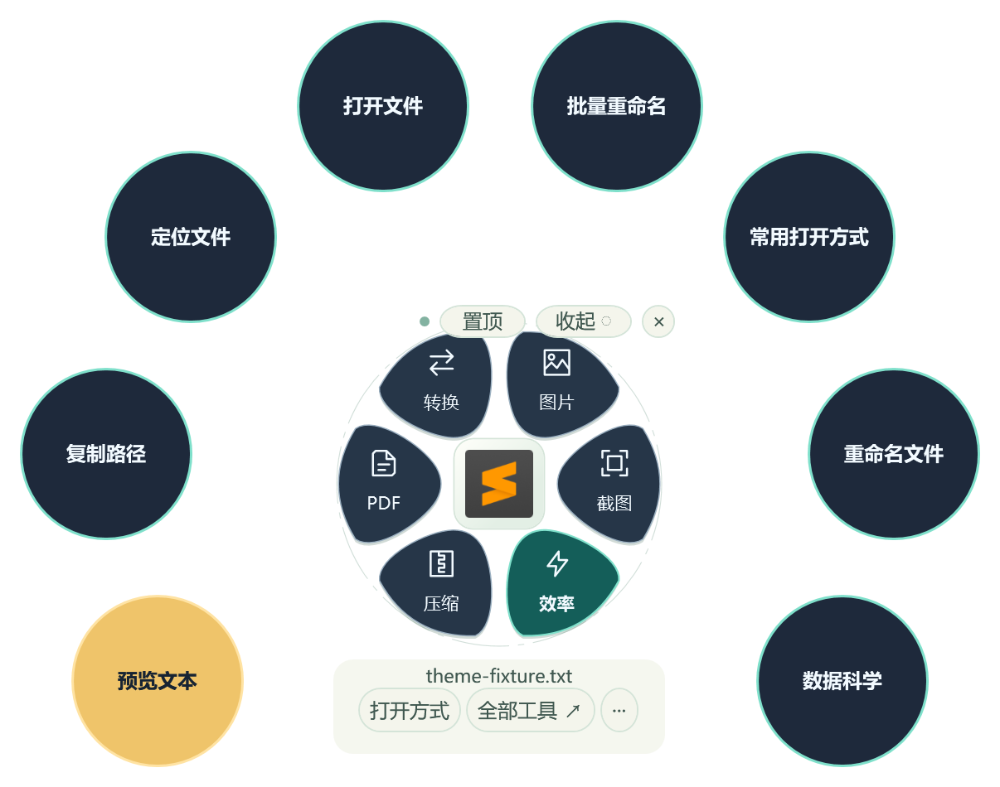
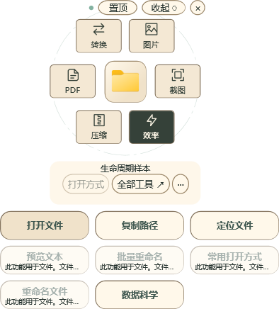
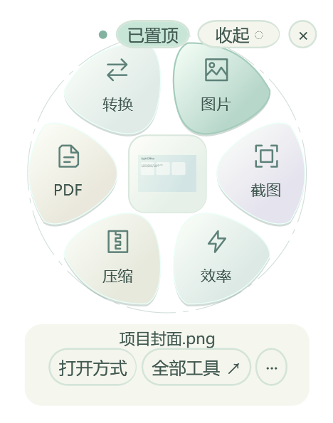
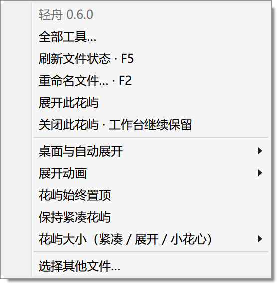
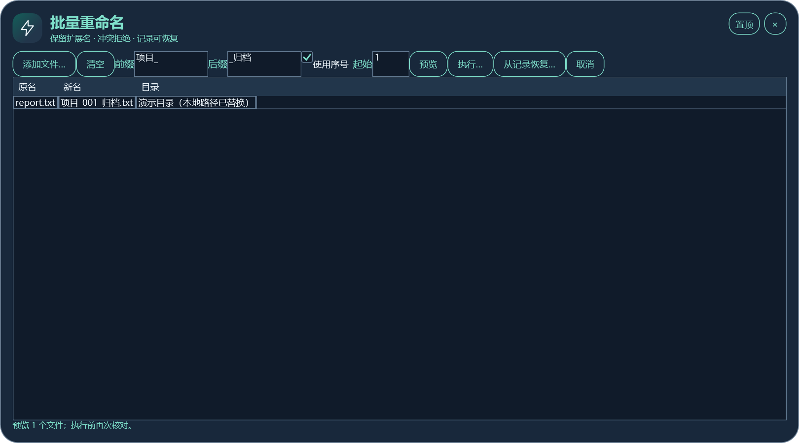
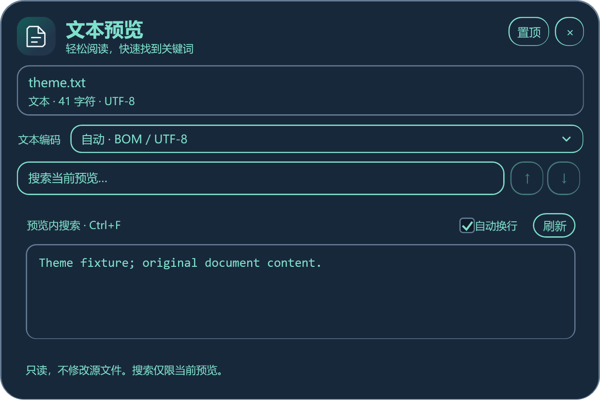

# 花屿、主题、打开方式和文件整理

[功能导航](catalog.md) · [功能手册](features.md) · [组件与安装](components.md)

基础桌面功能在 0.6 正式版可用；主题选择、手动启动显示修复和全工作台主题同步属于 0.7.2 正式版。版本差异见[0.7 说明](preview-0.7.md)。

## 主题与大小

花屿「···」、右键或托盘菜单 →「花屿主题」。经典为默认浅色花瓣和叶片列表；圆弧使用深色花瓣、圆形操作按钮，空间不足时回退列表。纸墨使用暖纸色圆角分类卡片、深墨选中态，收起标签与透明名称列表同步组配色。主题自动保存。

| 经典 | 圆弧 |
|---|---|
|  |  |

0.7.2 的独立工作台也同步换色，输入内容和当前数据保留；图片和图表原色保持。Windows 文件选择器与系统软件界面由系统或对应应用控制。

「保持紧凑花屿」可避免悬停放大；点击分类仍可展开。尺寸为小巧 140、标准 150、清晰 170 DIP，展开与小花心按比例联动，实际像素取决于 Windows 缩放。

## 不同分辨率与缩放

窗口按屏幕实际工作区与 DPI 缩放约束，避免标题和关闭入口落在屏外。0.7.4 修正设计最小尺寸超过有效工作区的问题：必要时降低窗口尺寸下限并为内容增加滚动，移回大屏后恢复原布局与内容；截图工具栏可换行、滚动。

这张图是合成小工作区的真实控件离屏渲染。1280×720 到 4K、100% 到 200% 的组合是布局专项，不等于逐台物理显示器验收；此前真实 144 / 96 DPI 双屏与 DISPLAY1 100% / 150% / 200% 测试另有证据，见[验证说明](validation.md)。

## 多开、收起与工作台置顶

「多开 +」保留当前文件花屿，最多十二个文件上下文；再选其他文件可分别操作。收起变小花心，点击恢复；关闭花屿不自动关闭独立工作台。工作台标题可拖动，右上角有置顶及关闭，花屿会话置顶和全局默认分别控制。

0.7.5.1补充了文件夹支持与收起名称。单击小花心图标或名称展开功能菜单，按住图标 /名称拖动，右键查看更多操作；×只关闭当前花屿，不删除文件。花屿内 `Ctrl+M` 控制当前收起 /展开，`Ctrl+Shift+M` 切换全部，正在编辑的目标跳过；这些不是系统全局快捷键，需要先点击花屿。F1可查看操作规则。文件夹提供打开 /定位 /复制路径，文件专用处理按类型禁用，文件夹改名请在资源管理器按F2。

### 0.7.5.1：分层浏览与配色

本节功能随0.7.5.1提供；安装旧版后请更新程序，使用方法如下。

1. 选中文件夹后「收起」，将鼠标停留在小花心或名称上约 0.4 秒。
2. 旁边出现透明胶囊滑动列表，每行仅显示名称，行间与外围空白透明；少量项目自动缩短，项目多时滚轮浏览。双击文件打开；双击文件夹进入；‹、Alt+Left 或 Backspace 返回上一级。原花心目标不变。
3. 单击子文件夹，等待系统双击判定后保留为独立花心；也可选中后在「···」或右键菜单选择「保留所选子文件夹为花心」。继续悬停这个新花心就能逐层浏览。文件单击只选择。
4. 母子花心独立关闭，重复路径复用，总数最多十二个。新花心在附近放置并尽量避让，位置可拖动。
5. 右键母文件夹或子文件夹 →「文件夹组配色 · 母子共享」，选择青竹、湖蓝、藤紫、麦穗或陶土。已配置祖先与其后代共享整组颜色，切换主题后映射相应配色。自动颜色按当前记录分配；手选后立即保存，也会随其他设置保存。
6. 右键花屿 →「花屿主题」→「纸墨 · 暖纸墨色卡片」。工作台输入和数据保留，图片与图表不染色。

预览初次显示 100 项，可继续加载至 2000 项；文件夹优先及名称排序只针对已加载集合。隐藏 / 系统项默认不显示，可在「···」/右键菜单勾选。鼠标离开约 0.5 秒或 Esc 关闭，图标与面板间保留过渡区。只读取当前层目录，不后台递归、不统计总大小、不生成文件内容缩略图；扫描最多两万项。权限不足或目录消失会显示错误并保留「···」/右键菜单中的刷新 / 资源管理器入口。网络 IO 在后台读取，关闭后丢弃迟到结果；路径联接不做实体去重。

| 经典预览 | 圆弧预览 | 纸墨预览 |
|---|---|---|
|  |  |  |

以上为合成目录的真实 WPF 控件渲染，不是实际鼠标操作录像。

| 收起的小花心 | 保留文件花屿 |
|---|---|
|  |  |

「全部工具」支持按分类和关键词查找，常用项优先展示，当前分类最多九项。工具不可用时显示原因，例如未选文件或格式不支持。

## 自动展开、暂停和监听恢复

「桌面与自动展开」提供总开关、暂停十分钟、当前文件夹排除、恢复所有排除目录和重新连接监听。自动展开等待双击判定，减少对双击打开文件的干扰。暂停不是退出软件，仍可手动呼出。

0.7.1 起手动启动直接显示花屿，重复启动唤起既有实例；登录自启使用后台参数，不主动弹出。旧版登记过自启时，在新运行版本关闭再开启一次，以更新实际路径。真实登录、休眠恢复和 Explorer 重启验收范围见[验证说明](validation.md)。

## Windows 默认与推荐打开方式

| 需求 | 正确操作 | 结果 |
|---|---|---|
| 沿用系统默认 | Windows 默认 / 跟随 Windows | 跟随系统当前关联 |
| 临时用其他软件打开 | 选择系统推荐或自定义 EXE | 本次由该程序打开 |
| 保留自己的常用程序 | 添加 EXE，最多三个 | 另加常用项，原默认入口保留 |
| 在轻舟内优先使用 | 明确设置「轻舟内优先」 | 只影响轻舟入口 |
| 在 Windows 推荐中添加 | 「加入系统推荐」 | 追加当前用户候选，不修改 UserChoice |
| 恢复系统行为 | 「跟随 Windows」 | 清除轻舟内优先语义 |

使用次数只用于推荐，不会自动改默认；移除轻舟记录不会卸载应用或删除其他系统关联。Windows 原生推荐的顺序、缓存和刷新由系统决定，商店应用使用系统处理程序调用。

## F2、单文件与批量重命名

单文件选中后按 F2，或选择「重命名文件」。只修改主文件名，保留扩展名，冲突时拒绝；成功后同步花屿和文件历史。轻舟未运行时 F2 仍由 Windows 处理。

批量改名支持 1–500 个文件、前后缀、保留原名或序号、起始序号，执行前先预览。图中的实际规则把 `report.txt` 变为 `项目_001_归档.txt`，本地目录已替换成演示文字。

执行前保存恢复 JSON，记录内容哈希；取消或部分失败时保留已完成项和记录。「从记录恢复…」核对内容及原名称占用，外部改动后停止。此操作会真实改变文件名，请先用少量副本试验；恢复记录含完整路径，不建议直接公开。

## 预览、定位和复制路径

文本预览只读，可搜索、上下命中跳转、清空条件、换行、刷新及切换编码；ZIP 目录预览查看条目与声明大小，无需解压。预览有预算，不是无限全文编辑器。

| 文本预览 | ZIP 目录 |
|---|---|
|  |  |

「定位文件」在资源管理器选中文件，「复制路径」写入完整路径。两者没有独立编辑窗口，图库使用真实入口展示，不伪造结果界面。

0.7.5.1 修复：预览关闭开始即停止计时器并取消读取；失焦、主题重绘和重复请求不会再次关闭正在退出的窗口。纸墨使用独立分类卡片、深墨选中态和暖纸组配色，与经典花瓣区分。
