# 全部功能手册 · 0.6.0

本页覆盖产品工具目录的全部 24 个入口，以及截图和数据科学的子操作。图片来自合成测试文件的真实界面；截图与实际执行的验证范围见[验证说明](validation.md)。

[快速使用](usage.md) · [常见问题](faq.md) · [完整图库](../screenshots/README.md)

| 分类 | 工具 | 演示 |
|---|---|---|
| 图片 | [调整尺寸](#resize) | [界面](../screenshots/image-resize.png) |
| 效率 | [预览文本](#text-preview) | [界面](../screenshots/text-preview.png) |
| 压缩 | [预览 ZIP](#zip-preview) | [界面](../screenshots/zip-preview.png) |
| 效率 | [打开文件](#open) | [界面](../screenshots/flower-efficiency.png) |
| 效率 | [批量重命名](#rename-batch) | [界面](../screenshots/batch-rename.png) |
| 图片 | [图片 / PDF 水印](#watermark) | [界面](../screenshots/watermark.png) |
| PDF | [PDF 添加水印](#pdf-watermark) | [界面](../screenshots/pdf-watermark.png) |
| PDF | [移除轻舟水印](#pdf-remove-watermark) | [界面](../screenshots/pdf-remove-watermark.png) |
| 效率 | [常用打开方式](#open-with) | [界面](../screenshots/open-with.png) |
| 效率 | [定位文件](#locate) | [界面](../screenshots/flower-efficiency.png) |
| 效率 | [复制路径](#copy-path) | [界面](../screenshots/flower-efficiency.png) |
| 效率 | [重命名文件](#rename) | [界面](../screenshots/rename.png) |
| 效率 | [数据科学](#data-science) | [界面](../screenshots/data-science.png) |
| 转换 | [图片格式转换](#image-convert) | [界面](../screenshots/image-convert.png) |
| 图片 | [裁剪与旋转](#crop) | [界面](../screenshots/image-crop.png) |
| 图片 | [图片批处理](#image-batch) | [界面](../screenshots/image-batch.png) |
| 转换 | [办公文档转 PDF](#document-convert) | [界面](../screenshots/office-convert.png) |
| PDF | [PDF 拆分](#pdf-split) | [界面](../screenshots/pdf-split.png) |
| PDF | [PDF 合并](#pdf-merge) | [界面](../screenshots/pdf-merge.png) |
| PDF | [PDF 统一 A4](#pdf-a4) | [界面](../screenshots/pdf-a4.png) |
| 截图 | [截图](#capture) | [界面](../screenshots/capture.png) |
| 截图 | [桌面贴图](#pin-image) | [界面](../screenshots/pinned-image.png) |
| 压缩 | [压缩文件](#compress) | [界面](../screenshots/archive-compress.png) |
| 压缩 | [解压文件](#extract) | [界面](../screenshots/archive-extract.png) |

## 转换

### 图片格式转换

- **入口**：转换花瓣 / 全部工具搜索「图片格式转换」。
- **输入**：PNG / JPG / BMP。
- **操作**：选择输出格式；JPG 可调质量；预览后另存。
- **输出**：PNG / JPG / BMP。
- **边界**：JPG 不保留透明通道；需核对背景与质量。
- **测试演示**：[查看原图](../screenshots/image-convert.png)。

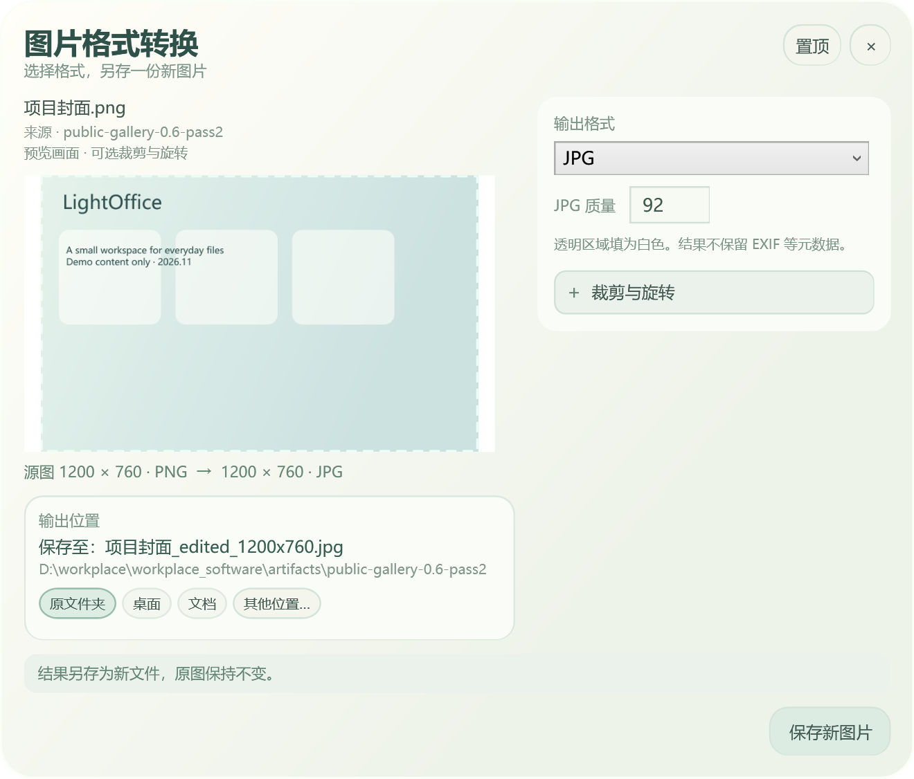

### 办公文档转 PDF

- **入口**：转换花瓣 / 全部工具搜索「办公文档转 PDF」。
- **输入**：DOCX / XLSX / PPTX。
- **操作**：配置 LibreOffice 或 Microsoft Office，确认转换引擎和输出目录，执行另存。
- **输出**：新 PDF。
- **边界**：需要本机可选引擎；字体 / 版式差异需复核；这是文档转换，不是大 XLSX 数据导入。
- **测试演示**：[查看原图](../screenshots/office-convert.png)。

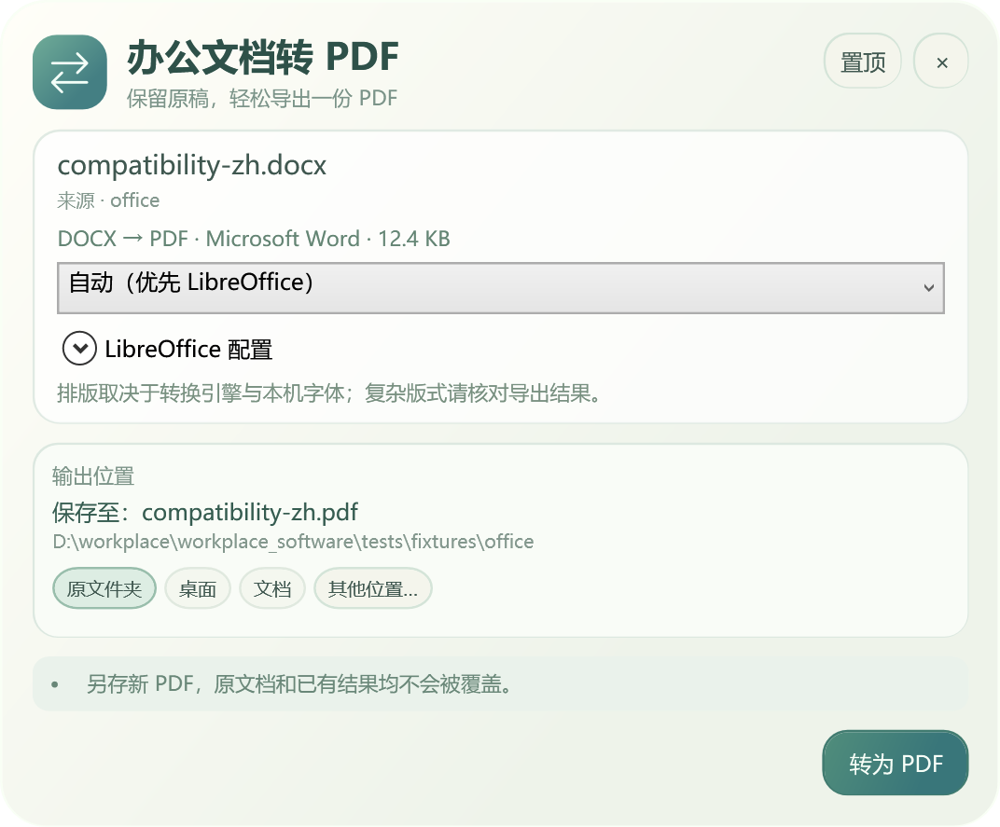

## 图片

### 调整尺寸

- **入口**：图片花瓣 / 全部工具搜索「调整尺寸」。
- **输入**：PNG / JPG / BMP。
- **操作**：输入宽高，按需锁定比例，确认目标尺寸后另存。
- **输出**：新图片。
- **边界**：较大原图可按目标尺寸解码；不原地覆盖。
- **测试演示**：[查看原图](../screenshots/image-resize.png)。

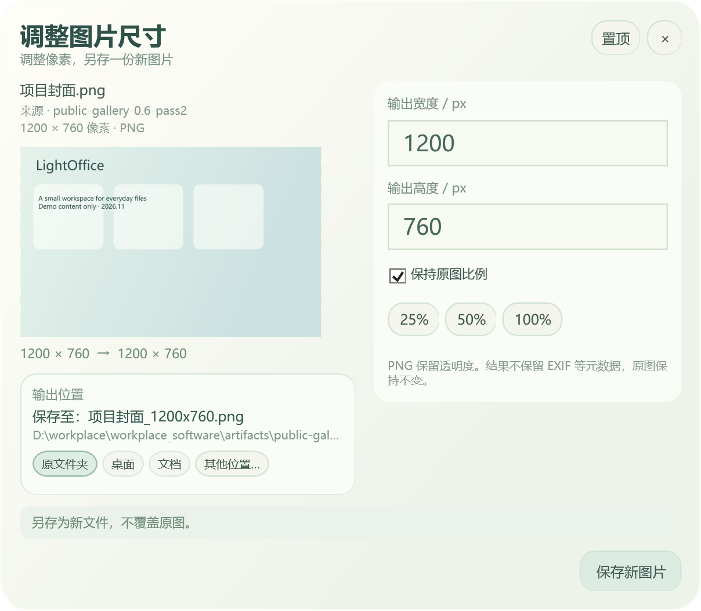

### 图片 / PDF 水印

- **入口**：图片花瓣 / 全部工具搜索「图片 / PDF 水印」。
- **输入**：PNG / JPG / BMP 或 PDF。
- **操作**：添加文件，输入单行文字，选择位置 / 透明度 / 字号，预览并批量另存。
- **输出**：图片输出 PNG；PDF 输出新 PDF。
- **边界**：最多 100 项；图片交互 1600 万像素；PDF 只预览水印位置。
- **测试演示**：[查看原图](../screenshots/watermark.png)。

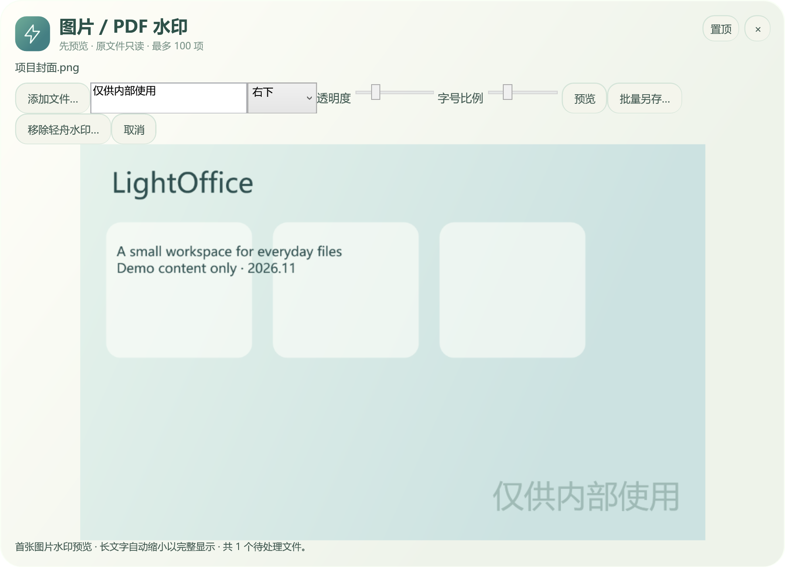

### 裁剪与旋转

- **入口**：图片花瓣 / 全部工具搜索「裁剪与旋转」。
- **输入**：PNG / JPG / BMP。
- **操作**：拖动裁剪框或输入像素，按 90°旋转，预览后另存。
- **输出**：新图片。
- **边界**：交互编辑上限 1600 万像素，不进行任意角度透视校正。
- **测试演示**：[查看原图](../screenshots/image-crop.png)。

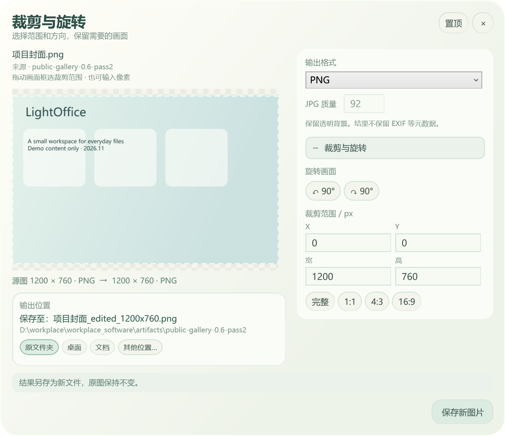

### 图片批处理

- **入口**：图片花瓣 / 全部工具搜索「图片批处理」。
- **输入**：多张 PNG / JPG / BMP。
- **操作**：添加 / 拖入图片，设置等比缩小和统一格式，按顺序执行。
- **输出**：多个新图片文件。
- **边界**：逐张处理；取消 / 失败保留已完成结果，不覆盖同名文件。
- **测试演示**：[查看原图](../screenshots/image-batch.png)。

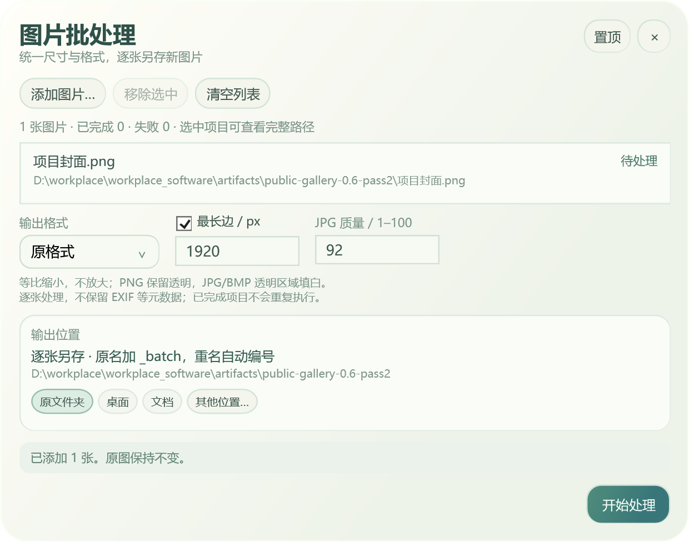

## PDF

### PDF 添加水印

- **入口**：PDF花瓣 / 全部工具搜索「PDF 添加水印」。
- **输入**：静态、未加密 PDF。
- **操作**：设置文字、左上 / 居中 / 右下、透明度与字号；检查位置预览后另存。
- **输出**：带轻舟恢复标记的新 PDF。
- **边界**：长文字缩小以完整显示；窗口不显示原页底图；加密 / 签名 / 表单暂不支持。
- **测试演示**：[查看原图](../screenshots/pdf-watermark.png)。

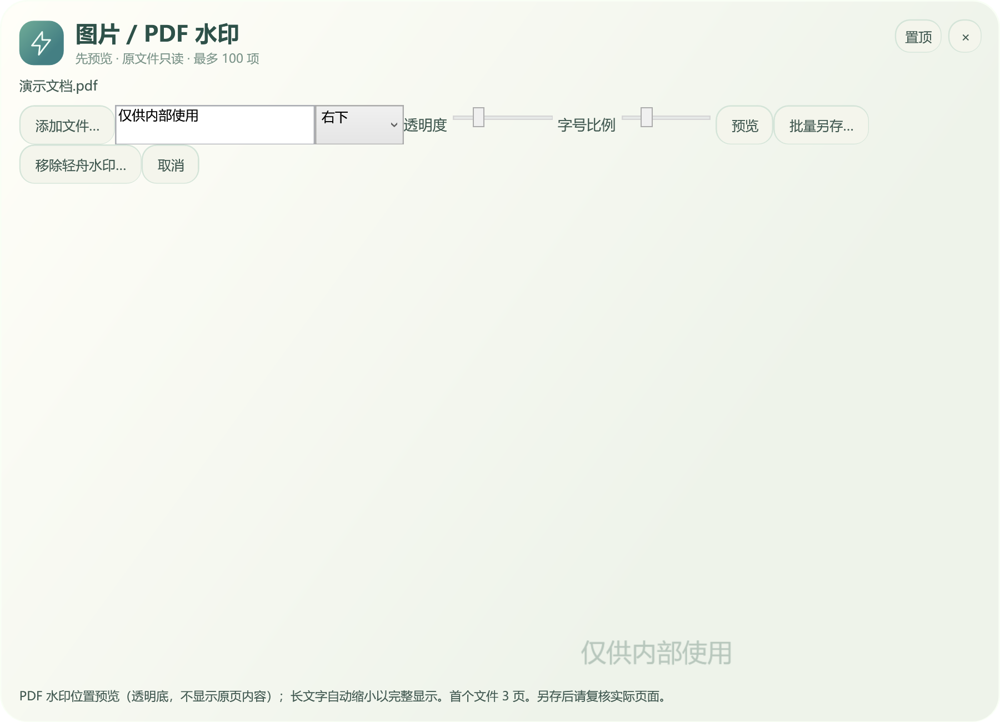

### 移除轻舟水印

- **入口**：PDF花瓣 / 全部工具搜索「移除轻舟水印」。
- **输入**：保留轻舟水印恢复标记的 PDF。
- **操作**：打开移除入口，选择输出目录，另存恢复原页面。
- **输出**：移除轻舟水印的新 PDF。
- **边界**：只识别本软件添加的水印；其他水印与扫描图不自动处理，无标记时拒绝输出。
- **测试演示**：[查看原图](../screenshots/pdf-remove-watermark.png)。

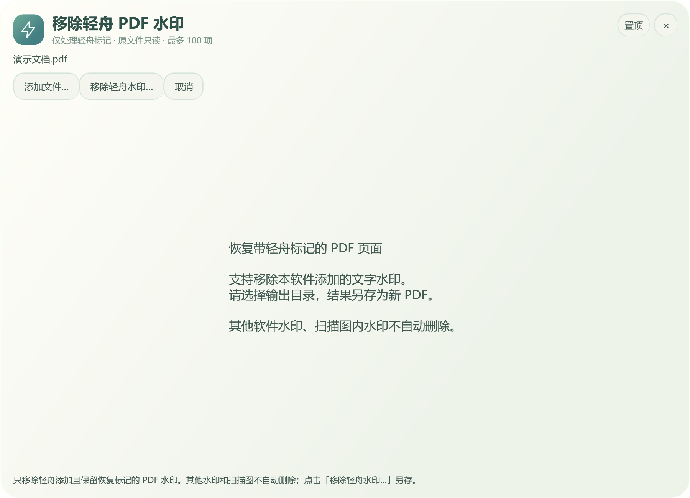

### PDF 拆分

- **入口**：PDF花瓣 / 全部工具搜索「PDF 拆分」。
- **输入**：静态、未加密 PDF。
- **操作**：输入单页或页面范围，可混合列表；预览页数后另存。
- **输出**：新 PDF。
- **边界**：范围必须有效；常见对象流可读取；签名 / 表单文档暂不处理。
- **测试演示**：[查看原图](../screenshots/pdf-split.png)。

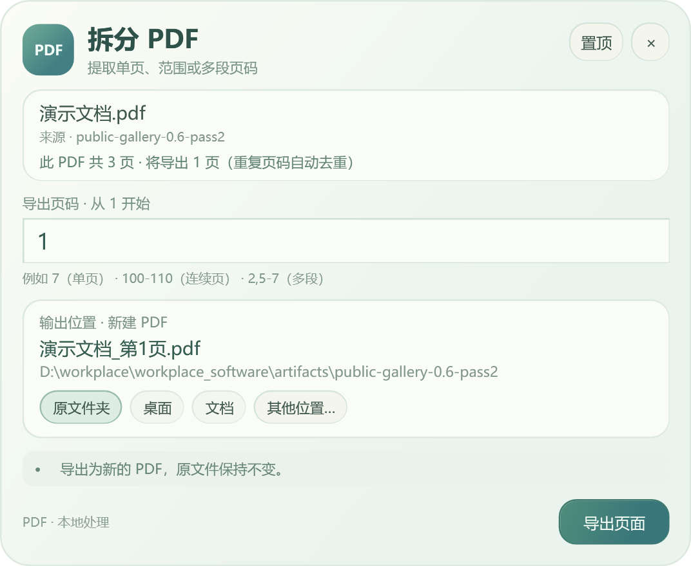

### PDF 合并

- **入口**：PDF花瓣 / 全部工具搜索「PDF 合并」。
- **输入**：至少两份静态、未加密 PDF。
- **操作**：添加文件，调整列表顺序，确认合并后另存。
- **输出**：按列表顺序合并的新 PDF。
- **边界**：不覆盖原文件；遇不支持输入时停止，不发布半成品。
- **测试演示**：[查看原图](../screenshots/pdf-merge.png)。

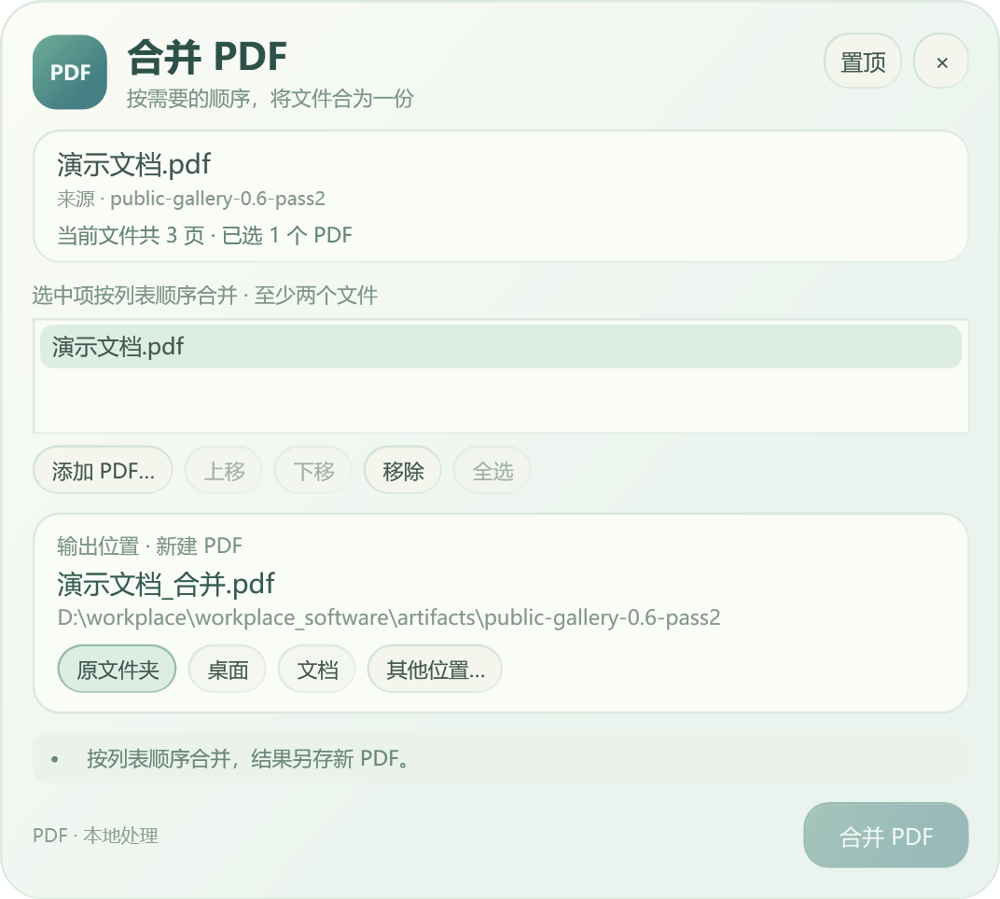

### PDF 统一 A4

- **入口**：PDF花瓣 / 全部工具搜索「PDF 统一 A4」。
- **输入**：扫描应用等生成的静态 PDF。
- **操作**：检查每页纸张尺寸，确认非 A4 页，等比例缩放并居中另存。
- **输出**：统一为 A4 的新 PDF。
- **边界**：保留横纵方向；非等比拉伸不会使用；特殊页面单位等会明确提示。
- **测试演示**：[查看原图](../screenshots/pdf-a4.png)。

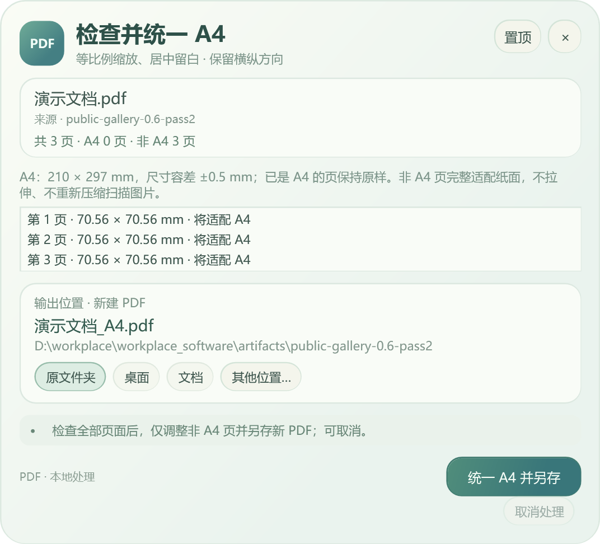

## 截图

### 截图

- **入口**：截图花瓣 / 全部工具搜索「截图」。
- **输入**：当前屏幕、窗口或框选区域。
- **操作**：选区 / 窗口 / 全屏；矩形、箭头、文字、打码后复制、保存或贴图。
- **输出**：剪贴板图片 / PNG / 桌面贴图。
- **边界**：交互上限 1600 万像素；识别与翻译见下表。
- **测试演示**：[查看原图](../screenshots/capture.png)。

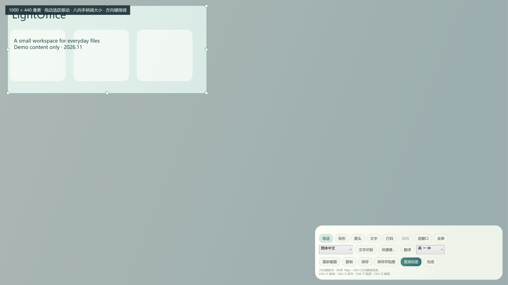

### 桌面贴图

- **入口**：截图花瓣 / 全部工具搜索「桌面贴图」。
- **输入**：PNG / JPG / BMP 或截图结果。
- **操作**：选择贴图，拖动摆放，按需置顶、调整显示并关闭。
- **输出**：会话中的桌面贴图。
- **边界**：关闭贴图不删除原图片；不写入图片内容。
- **测试演示**：[查看原图](../screenshots/pinned-image.png)。

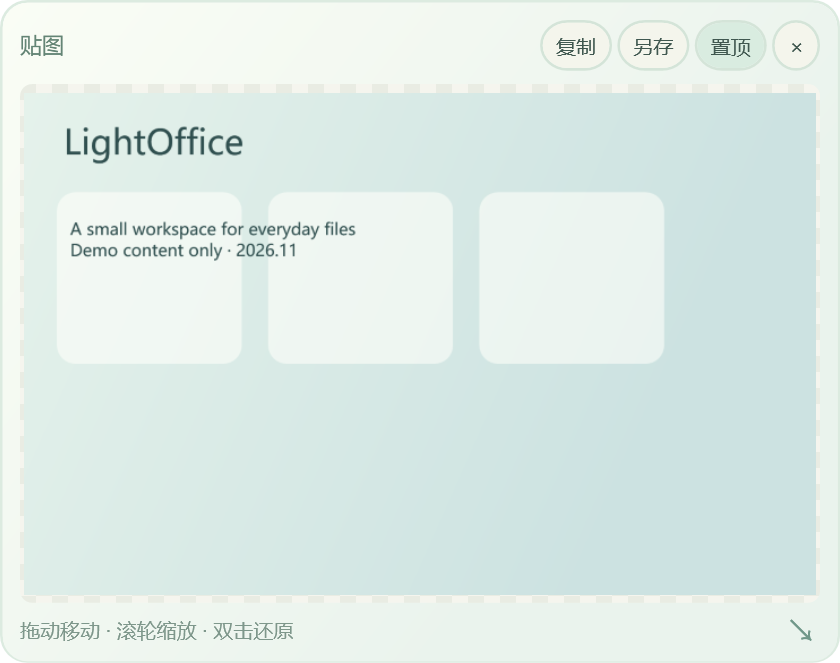

## 压缩

### 预览 ZIP

- **入口**：压缩花瓣 / 全部工具搜索「预览 ZIP」。
- **输入**：ZIP。
- **操作**：查看目录、项目与声明大小，无需先解压。
- **输出**：只读目录预览。
- **边界**：当前目录预览只支持 ZIP，不是 7z / RAR 浏览器。
- **测试演示**：[查看原图](../screenshots/zip-preview.png)。

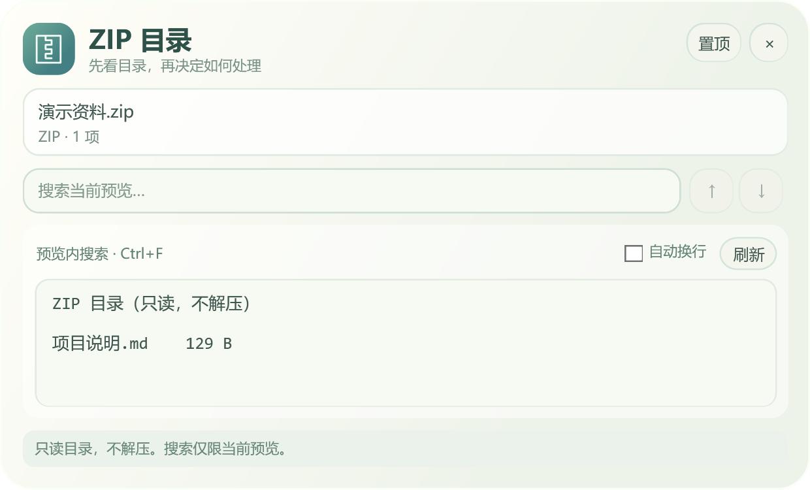

### 压缩文件

- **入口**：压缩花瓣 / 全部工具搜索「压缩文件」。
- **输入**：一个或多个文件 / 文件夹。
- **操作**：选择输出，按需展开多源与压缩增强；配置可选引擎后选格式与线程数。
- **输出**：ZIP；7-Zip 可输出 7z。
- **边界**：内置 ZIP 无需引擎；已有 Bandizip 用于 ZIP；不创建 RAR。
- **测试演示**：[查看原图](../screenshots/archive-compress.png)。

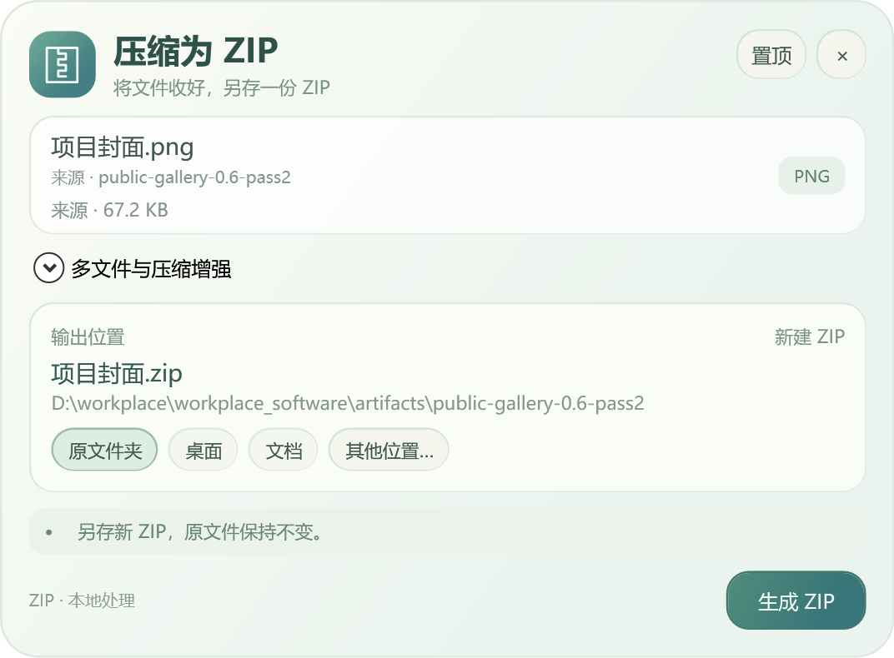

### 解压文件

- **入口**：压缩花瓣 / 全部工具搜索「解压文件」。
- **输入**：ZIP；配置 7-Zip 后可用普通 7z / RAR。
- **操作**：选择输出位置，检查源文件，解压到新目录。
- **输出**：新的目录和文件。
- **边界**：一万项、512 MiB 声明数据；拒绝穿越、链接、加密 / 分卷，失败不发布半成品目录。
- **测试演示**：[查看原图](../screenshots/archive-extract.png)。

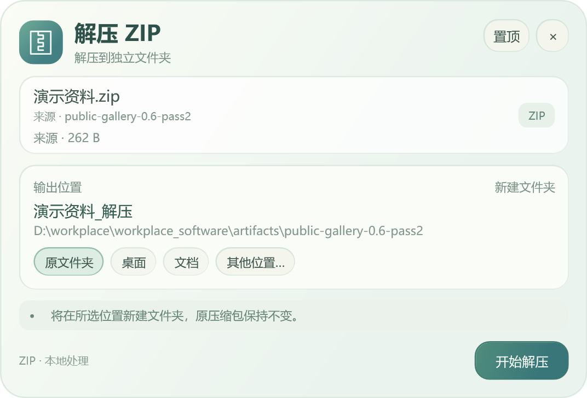

## 效率

### 预览文本

- **入口**：效率花瓣 / 全部工具搜索「预览文本」。
- **输入**：TXT / Markdown / CSV / JSON 等文本。
- **操作**：打开预览，按需选择编码，查看有限内容。
- **输出**：只读文本窗口。
- **边界**：预览有预算，不是全文编辑器；文件不改写。
- **测试演示**：[查看原图](../screenshots/text-preview.png)。

### 打开文件

- **入口**：效率花瓣 / 全部工具搜索「打开文件」。
- **输入**：当前文件。
- **操作**：点击花心或效率分类的打开文件；默认使用 Windows 关联。
- **输出**：对应应用进程。
- **边界**：只有明确设置轻舟内优先才覆盖轻舟入口；此通用动作图为入口展示，不代表逐格式启动验收。
- **测试演示**：[查看原图](../screenshots/flower-efficiency.png)。

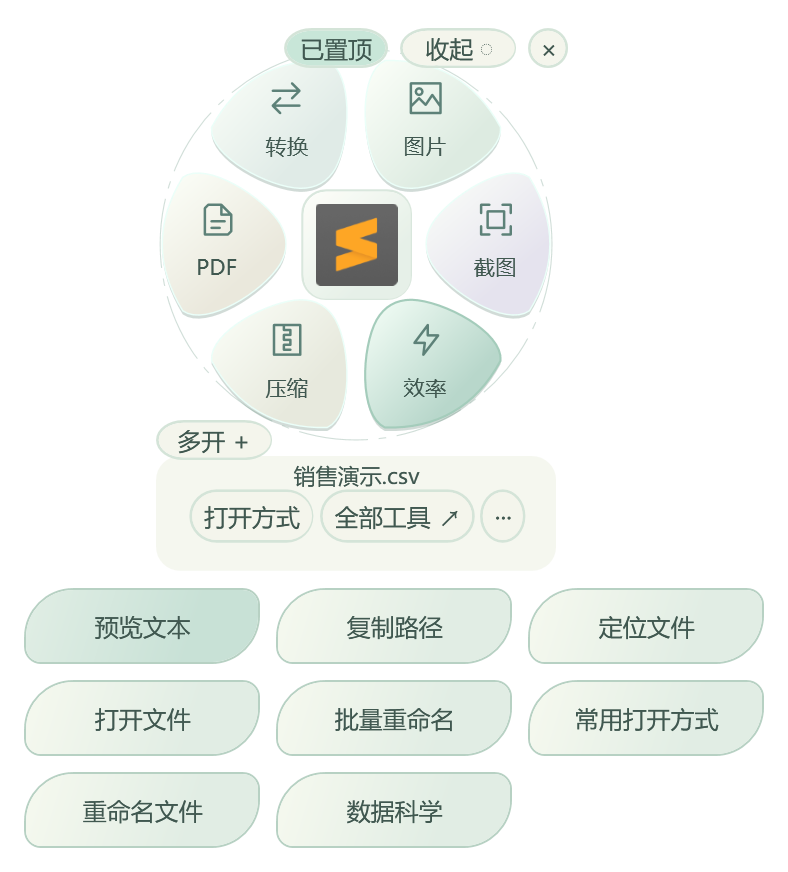

### 批量重命名

- **入口**：效率花瓣 / 全部工具搜索「批量重命名」。
- **输入**：1–500 个文件。
- **操作**：添加文件，前后缀 / 序号预览，保存恢复 JSON 后执行；需要时从记录恢复。
- **输出**：新文件名和恢复记录。
- **边界**：哈希复核、冲突拒绝；恢复不覆盖，外部修改时停止；记录含完整路径。
- **测试演示**：[查看原图](../screenshots/batch-rename.png)。

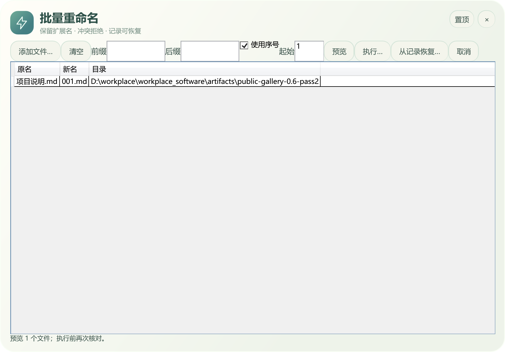

### 常用打开方式

- **入口**：效率花瓣 / 全部工具搜索「常用打开方式」。
- **输入**：当前文件及系统可用应用。
- **操作**：使用 Windows 默认 / 推荐应用；另加最多三个 EXE；管理排序或显式轻舟内优先。
- **输出**：由所选程序打开当前文件。
- **边界**：原默认始终保留；追加系统推荐不改 UserChoice；原生列表刷新由 Windows 控制。
- **测试演示**：[查看原图](../screenshots/open-with.png)。

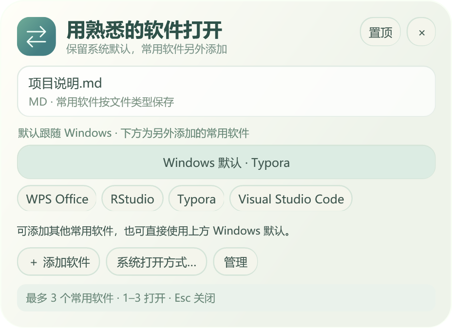

### 定位文件

- **入口**：效率花瓣 / 全部工具搜索「定位文件」。
- **输入**：当前文件。
- **操作**：点击定位，在资源管理器中选中对应文件。
- **输出**：资源管理器定位。
- **边界**：文件已移动或不可访问会提示；通用入口图，不单独伪造输出图。
- **测试演示**：[查看原图](../screenshots/flower-efficiency.png)。

### 复制路径

- **入口**：效率花瓣 / 全部工具搜索「复制路径」。
- **输入**：当前文件。
- **操作**：点击复制路径，粘贴到需要的位置。
- **输出**：剪贴板中的完整路径。
- **边界**：路径可能含私人信息；通用入口图，不把剪贴板内容公开。
- **测试演示**：[查看原图](../screenshots/flower-efficiency.png)。

### 重命名文件

- **入口**：效率花瓣 / 全部工具搜索「重命名文件」。
- **输入**：当前单文件。
- **操作**：点击改名或在 Shell 选中后按 F2，修改主名称，确认。
- **输出**：新文件名。
- **边界**：保留扩展名，拒绝冲突并同步花屿与历史；其他相关工作台需先关闭。
- **测试演示**：[查看原图](../screenshots/rename.png)。

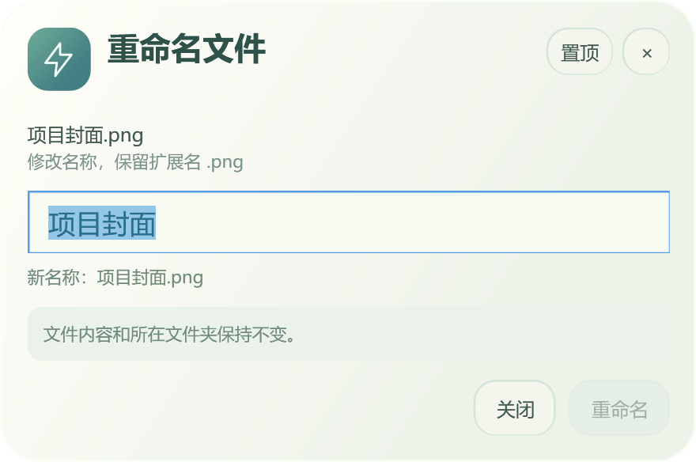

### 数据科学

- **入口**：效率花瓣 / 全部工具搜索「数据科学」。
- **输入**：CSV / TSV。
- **操作**：先预览，配置筛选、清理、选列和汇总，按需保存流程，再全文件另存。
- **输出**：CSV / TSV、流程 JSON、PNG 图表。
- **边界**：没有 XLSX 结构化导入；字段、记录、预览、去重 / 分组状态都有预算。
- **测试演示**：[查看原图](../screenshots/data-science.png)。

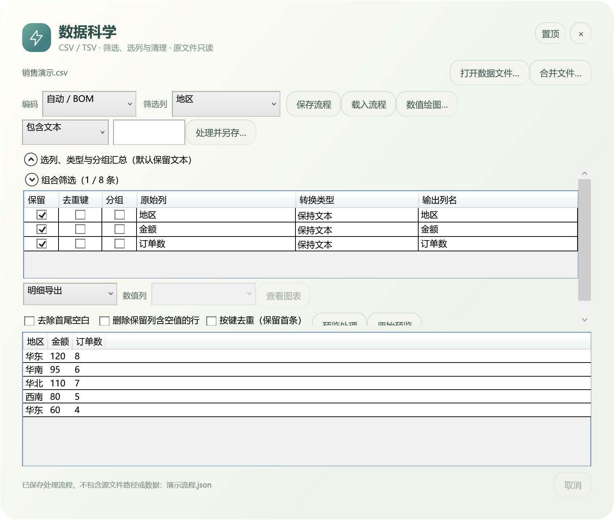

## 截图子操作

| 子操作 | 使用与结果 | 演示 |
|---|---|---|
| 本地 OCR | 简体中文 / 英语 / 系统首选语言；识别结果可编辑与复制，依赖已安装系统语言能力，不上传截图 | [识别](../screenshots/capture-ocr.png) |
| 中英翻译 | 主动请求 MyMemory，文字分段、超时、取消；原文与译文显示在 GUI 内，失败保留原文 | [翻译](../screenshots/capture-translation.png) |
| 快捷键 | 默认 Ctrl+Alt+S、Ctrl+Shift+O、Ctrl+Shift+T，可配置并拒绝冲突 | [设置](../screenshots/shortcuts.png) |
| 标注与输出 | 矩形 / 箭头 / 文字 / 打码，复制图片、PNG 另存或桌面贴图 | [截图](../screenshots/capture.png) |

## 数据科学子操作

| 子操作 | 使用与限制 | 演示 |
|---|---|---|
| 有限预览与编码 | 默认最多 200 行、512 列、预览 2 Mi 字符；编码可切换。另存扫描全文件 | [数据工作台](../screenshots/data-science.png) |
| 筛选 | 文本包含 / 等于 / 不含 / 不等、空值 / 非空、数值比较 / 区间、日期比较 / 区间；最多 8 条按全部或任一组合 | [数据工作台](../screenshots/data-science.png) |
| 选列与列名 | 调整输出列及名称，复核空名和重复列名 | [数据工作台](../screenshots/data-science.png) |
| 类型 | 文本、十进制、指定日期格式；无效非空数据报行，不静默修正 | [数据工作台](../screenshots/data-science.png) |
| 清理 | 去首尾空白、空行、空值处理，先预览后执行 | [数据工作台](../screenshots/data-science.png) |
| 按键去重 | 选择一列或多列作为键；有键数 / 内存预算，超限停止 | [数据工作台](../screenshots/data-science.png) |
| 分组汇总 | 多列键，计数 / 求和 / 平均 / 最小 / 最大；有分组状态预算 | [汇总图](../screenshots/data-chart.png) |
| 按行追加 | 同表头同顺序的 2–100 份 CSV / TSV，逐文件处理、单表头输出，支持取消 | [追加](../screenshots/data-append.png) |
| 保存 / 载入流程 | 版本 1 JSON，核对列名顺序和编码；不含原路径 / 原始行，参数仍可能含业务词 | [工作台](../screenshots/data-science.png) |
| 汇总条形 / 分类折线图 | 来自分组汇总；可保存 PNG，分类折线不代表连续时间序列 | [汇总图](../screenshots/data-chart.png) |
| 数值直方图 | 全文件扫描后固定种子抽样，10 / 20 / 40 个等宽箱，末箱含最大值 | [直方图](../screenshots/data-histogram.png) |
| 散点图 | 选择 X / Y 数值列，界面最多一千点；有效 / 空值 / 扫描 / 样本数明确显示 | [散点图](../screenshots/data-scatter.png) |

## 桌面与组件

三档紧凑 / 展开 / 小花心尺寸联动、六类分类、最多九项叶片操作、多开十二个文件花屿、窗口标题拖动 / 关闭 / 置顶、托盘窗口找回、登录自启、暂停 / 排除目录、五种展开动画、可选组件检测 / 配置 / 导入 / 停用 / 移除及关于页。

[花屿](../screenshots/flower.png) · [小花心](../screenshots/flower-badge.png) · [多开](../screenshots/flower-retained.png) · [组件](../screenshots/components.png) · [关于](../screenshots/about.png)

登录、休眠和真实多屏 DPI 切换并未因几何检查或界面图自动视为通过。见[验证说明](validation.md)。
