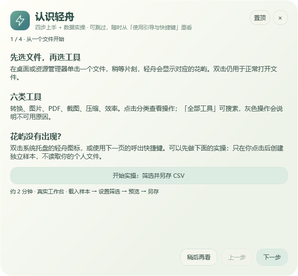
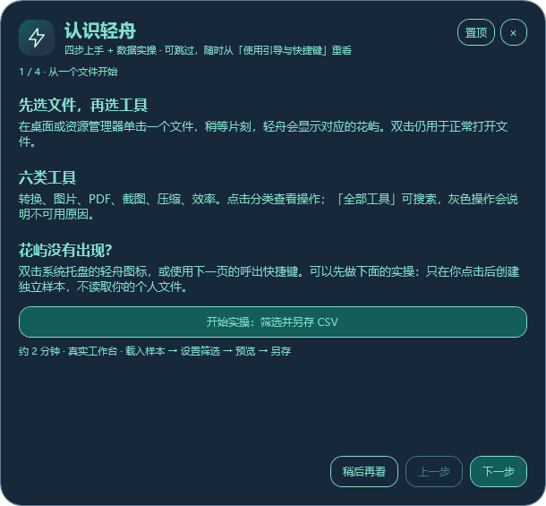
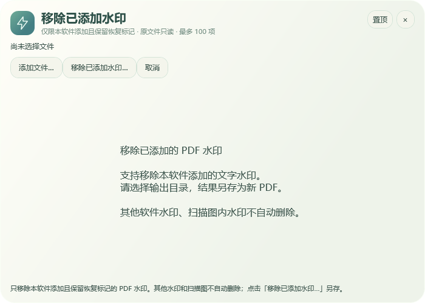

# 操作教学与用到时的快捷键提示

[三分钟上手](quickstart.md) · [截图专题](capture.md) · [版本变化](changelog.md)

0.7.4.0 增加首次引导、真实数据练习与小尺寸快捷键提示。当前 0.7.5.1 默认使用经典浅色，也支持圆弧与纸墨主题；引导窗口跟随当前主题。新增的文件夹悬停、母子花心及配色操作见[桌面指南](desktop.md)。

## 先认识入口，也可以稍后再看

第一次手动启动时显示四步引导，介绍花屿、全部工具、常用按键和托盘。升级后尚未完成引导的用户也会看到一次。选择「完成，不再自动显示」才保存完成状态；关闭、Esc 或稍后再看会保留未完成状态。

登录后台启动或带文件参数启动时不弹引导。需要重看时，在托盘或花屿菜单选择「使用引导与快捷键…」，或在花屿获得焦点时按 F1。

| 经典主题 | 圆弧主题 |
|---|---|
|  |  |

图片是 0.7.4.0 真实控件的离屏渲染，不是鼠标操作录像。

## 跟着做一次真实的数据处理

引导首页点击「开始实操：筛选并另存 CSV」，在真实数据科学工作台按以下步骤操作：

1. 点击「载入练习样本」，创建独立的六行订单 CSV。
2. 筛选列选择「地区」，方式选择「等于文本」，输入「华东」。
3. 点击「预览处理」，核对三条预期订单。
4. 点击「处理并另存…」，选择新的 CSV 路径。真实导出并校验结果后才显示完成。

顶部说明和目标高亮随操作变化；参数改变、导出失败或取消都不会假报完成。练习只处理独立样本，原文件只读；临时样本和主动保存的结果保留，可由用户自行清理。基础引导可以单独完成，不强制通过实操。

## 经常用截图，再轻轻提醒一次

软件只在本地记录最近十次截图是菜单还是快捷键触发。如果最近至少六次中菜单至少五次、快捷键最多一次，且本次从菜单打开，就可能在截图工具栏显示一行小提示。

图中使用测试配置 Ctrl+Alt+K，实际显示用户保存的组合键；默认截图键为 Ctrl+Alt+S。标签最大宽 300 DIP、11 DIP 字体，七天最多一次、累计最多三次；重新激活已打开的截图窗口不重复计数。点击 × 可关闭后续提示，也可在「截图快捷键」中关闭或重新开启。不会上传使用标记，也不记录截图、识别文字或文件路径。

## 截图画笔与 Enter 复制

框选后，在第一行「框选」右侧点击「画笔」，按住鼠标标记。颜色和粗细作用于后续笔画；Ctrl+Z 整笔撤销，绘制中 Esc 取消本笔。经典与圆弧主题入口一致。

截图完成后按 Enter，复制含标注的图片并关闭截图框；到聊天框或 APP 按 Ctrl+V 粘贴，不必先保存文件，也不会自动发送。Ctrl+C 只复制并保留编辑器；Ctrl+S 另存 PNG。输入文字、编辑识别结果和选择语言时 Enter 保持原用途；复制失败保留窗口。

## 一次操作完成后收起窗口

| 操作 | 成功后 | 未成功时 |
|---|---|---|
| F2 单文件重命名 | 自动关闭 | 保留输入和错误提示 |
| 保存截图快捷键、翻译服务设置 | 校验和保存成功后关闭 | 保留窗口，恢复原配置 |
| 图片、PDF、压缩、文档转换、数据科学、批量改名 | 保留结果，方便核对和连续处理 | 保留错误、已完成结果和重试入口 |

文件已改名但关联记录保存失败时，窗口会保留警告并禁止重复提交。截图快捷键提示开关、翻译测试连接这类原位操作保持窗口打开。

## PDF 名称与反馈

「移除轻舟水印」改名为「移除已添加水印」，仅适用于本软件添加且保留恢复标记的 PDF 水印，结果另存新文件。其他软件或扫描图片中的水印不自动删除，旧版本和历史演示图仍可能使用旧名。

关于页显示软件名称、实际版本、开发者 Mengqy 和开发平台 Codex。可前往[博客评论](https://www.mqymmb.com/posts/lightoffice/#license-note)，或发送邮件至 **15877464851@163.com**；软件只打开页面或系统邮件草稿，不自动发送反馈。
