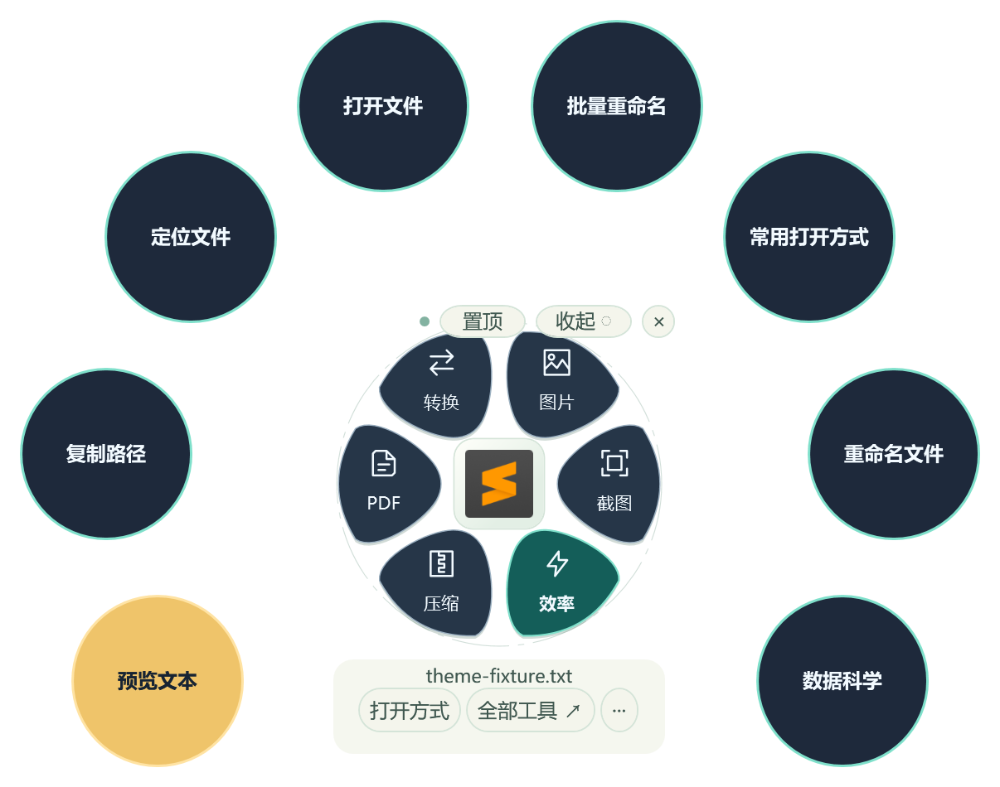
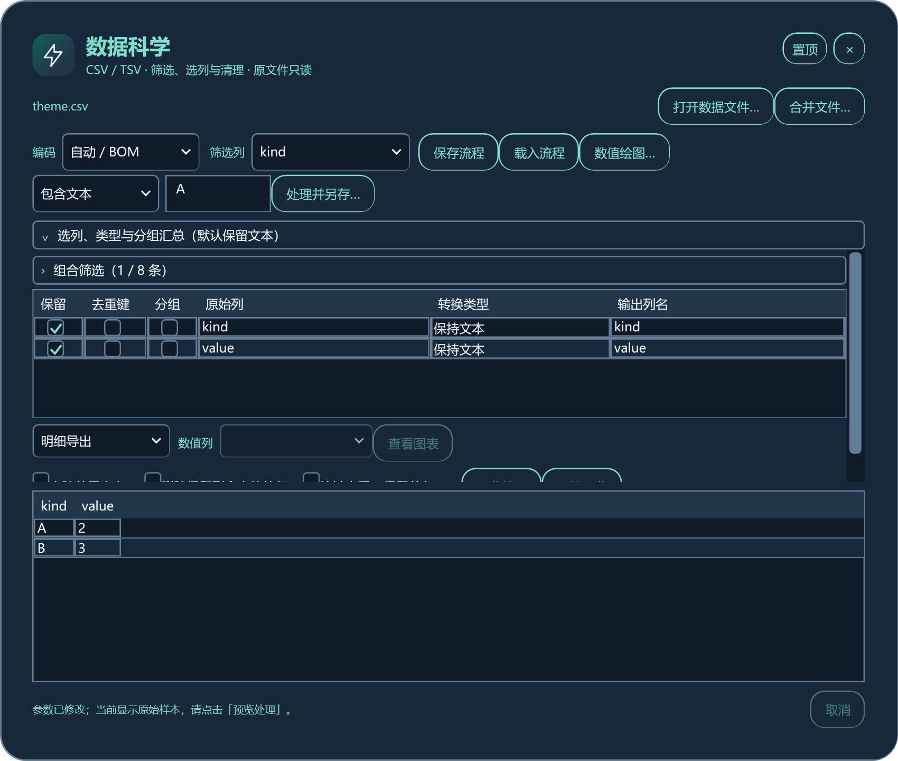
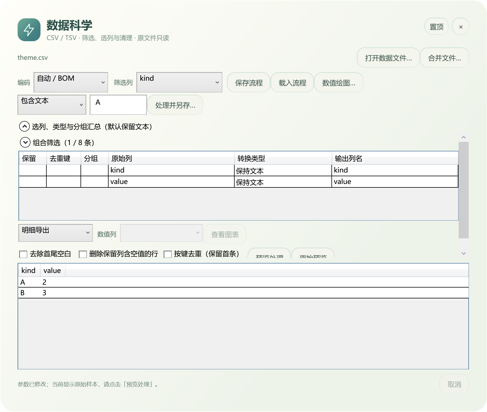
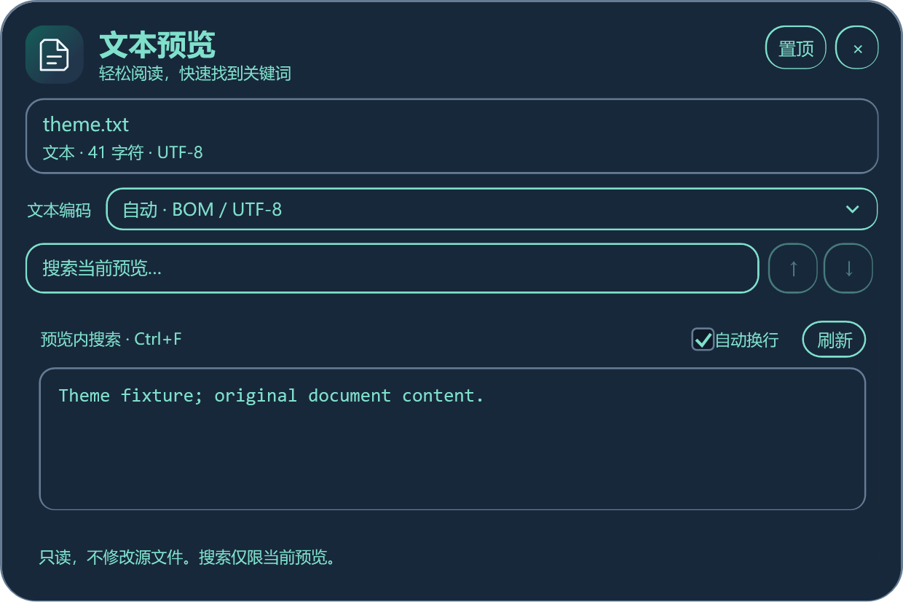
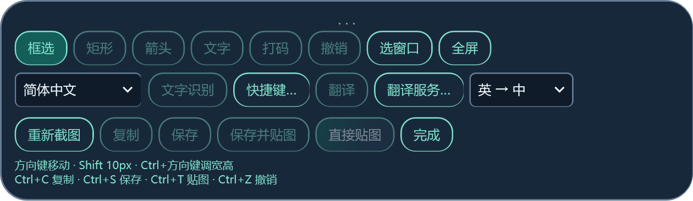
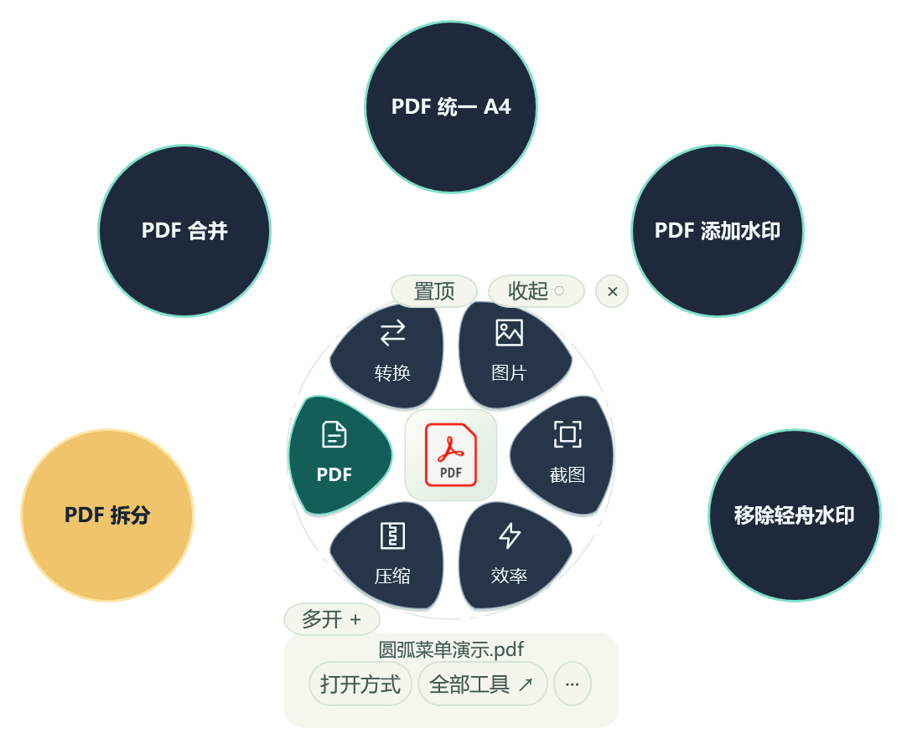
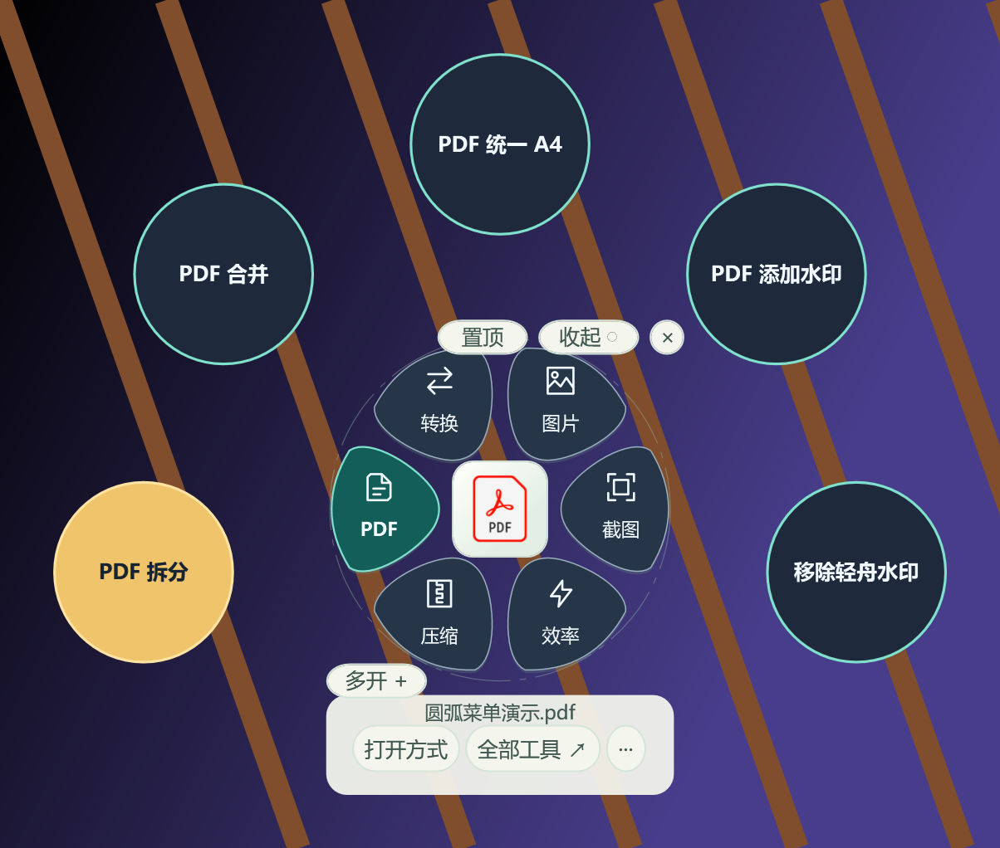
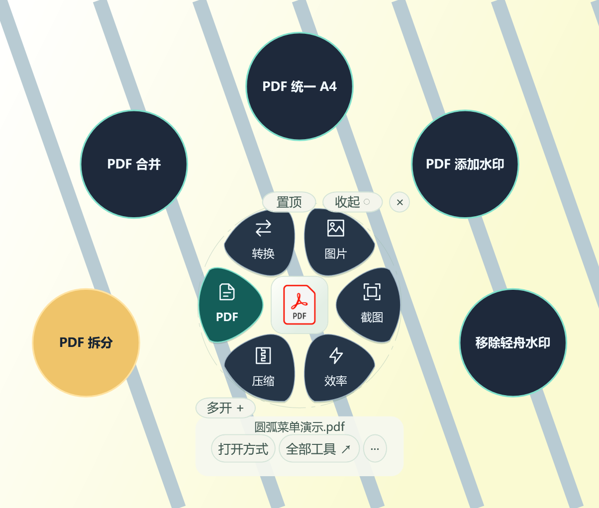

# 0.7 本地候选使用说明

版本：0.7.2.0。当前为本地候选，公开正式下载仍以 Releases 页面为准。下图来自候选程序的真实 WPF 视图，使用合成文件与合成背景，不包含私人屏幕。

## 启动修复与主题选择

双击程序或「启动轻舟.cmd」后直接显示花屿；重复启动会唤起正在运行的实例。关闭花屿后仍在托盘运行，可从托盘或再次启动唤起。「开机时启动轻舟」使用独立后台参数，登录后不主动弹出花屿；这是正常后台运行。旧版本已登记的登录启动项，可在新版本关闭再开启一次，以使用新的后台启动命令。

在花屿下方「···」、花屿右键或托盘菜单中，打开「花屿主题」：

- **经典 · 浅色花屿**：保留原有浅色花瓣和叶片操作列表，也是新安装和旧配置的默认值。
- **圆弧 · 高对比扇形菜单**：使用深色花瓣、沿圆弧排列的圆形操作和强调色，作为可选新主题。

主题选择立即更新可见花屿并自动保存，重启后继续使用。已收起/隐藏的花屿维持状态，独立工作台、文件与常用项保留。无法保存设置时会提示「仅本次生效」，解除文件占用后重新选择主题即可保存。主题不需要额外运行库。

## 工作台同步主题

圆弧主题现在同步覆盖数据科学、PDF、文档转换、图片工具、压缩、打开方式、批量改名、工具库、预览、翻译设置及截图工具栏。深蓝背景配浅色正文、青绿强调和琥珀提示，输入框、下拉框、表格、复选框、滚动区域和输出位置面板一起换色。已打开窗口可直接切换，输入参数、筛选内容和预览数据保留；切回经典即恢复浅色。

主题仅调整软件界面。图片、文档预览、截图标注色板和图表导出的原色保留。Windows 文件选择器、系统打开方式和第三方软件界面由系统或对应软件控制。

本轮 135 项工作台主题专项使用合成文件，在 1 号屏幕显示；窗口原生位置约束避免越界，测试进程没有成为前台，无物理鼠标键盘注入。截图工具栏使用合成位图，不截取用户桌面；重命名和贴图仅作离屏渲染检查。此范围不等同全部功能或真实操作回归。

## 圆弧操作与反差色

选择圆弧主题后，点击花屿的分类，操作按钮沿花屿外圈展开；常用项优先，最多九项。PDF 显示拆分、合并、统一 A4、添加水印和移除轻舟水印五项。主要操作使用琥珀色，其他操作采用深底浅字，当前分类使用青绿色并加粗文字。Tab 可在可用控件间移动，Enter/Space 执行；数字 1–6 继续切换分类。

圆形按钮只有可见圆面接收点击，透明角落不挡桌面。禁用操作显示简短原因，悬停和辅助功能提供完整说明。窗口布局避开文件名和置顶/收起/关闭区域；屏幕有效空间不足时自动使用紧凑列表，长名称可悬停查看。此布局没有新增运行库。

## 数据科学与改名恢复

数据流程 JSON、直方图及散点图沿用 0.6 的操作入口。修改数值图的列、图形类型或分箱后，旧图失效，需重新扫描；正在扫描或已取消时不能导出旧图。源文件变化后请关闭数值绘图窗口并从更新后的数据重新打开。恒定大数值可绘图，坐标采用近似浮点数，精确数据仍以原始文件为准。

批量改名恢复记录仍使用原子写入。遇到短暂读取占用会有限重试；持续占用时保留旧记录并报错。若文件名已改变而记录未更新，请保留记录并检查当前文件状态，解除占用后再恢复，不要手动删除记录。

## 可选组件与安装

PDF 水印预览可以读取真实首页；Windows 缩略图处理器不可用时，可在「可选组件」选择已有 MuPDF 的 mutool.exe。MuPDF 不随基础包分发，未配置可用渲染器时预览会说明原因。LibreOffice、压缩增强和翻译服务配置继续按需使用。

安装版在当前用户目录中为 0.7.2.0 建立独立版本目录、版本快捷方式和程序卸载项。旧版保留；通用快捷方式选择现存最高版本，卸载该版本后重新选择剩余版本。卸载保留个人设置与可选组件。便携包仍可直接解压运行，必须保留全部 DLL、配置与许可。切换版本前退出旧程序；需要登录自启时在实际运行版本重新设置。

## 验证边界

候选已执行菜单几何、圆形命中、操作路由、对比度、数值图失效/取消、大数轴与改名记录锁定专项。当前 100%/150% 双屏窗口定位有专项；100%–300% 合成几何不代替真实显示设置切换。没有用重启、注销或休眠用户电脑来验收系统恢复。

真实登录、睡眠/休眠、Explorer 重启、显示器热插拔、干净系统安装/卸载以及长期资源峰值仍待验收。DuckDB 仅做独立技术探针，未接入数据工作台；500MB–2GB XLSX 处理继续不在当前能力内。本地候选未代码签名、未作为正式 Release 发布。

[基础使用](usage.md) · [全部功能](features.md) · [验证说明](validation.md)
