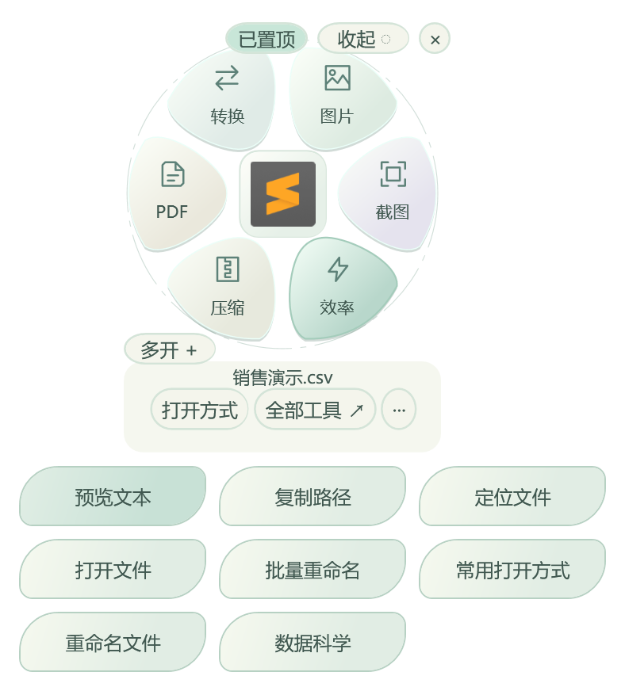

# 三分钟上手轻舟

[下载安装](../releases/README.md) · [六个任务教程](tutorials.md) · [遇到问题](troubleshooting.md)

适用 Windows 10 / 11、系统 .NET Framework 4.8。本页对应 0.7.5.1，旧版差异见[版本对照](versions.md)。基础使用无需安装 Microsoft Office、Python 或 R。

首次手动启动会显示四步引导，可直接开始真实的 CSV 筛选与另存练习；随时可从托盘「使用引导与快捷键…」重看。详见[操作教学与按需提示](getting-started.md)。

## 第一分钟：安装或解压

1. 在 [Releases](https://github.com/mengqy2022/LightOffice-Public/releases/latest) 下载 Setup，或选择便携 ZIP；需要核对时按[下载说明](../releases/README.md)比较 SHA-256。
2. 安装版按向导阅读许可与说明、选择可写目录和快捷方式，自启默认关闭；详见[安装指南](installation.md)。完成后可勾选运行；便携版解压整个目录，再运行 `LightOffice.exe`。保留同目录 DLL、配置与许可，不要只复制 EXE。
3. 查看任务栏右侧托盘，必要时展开隐藏图标。0.6 首次手动启动可能只在托盘运行，选中文件后呼出；0.7.1 起修复了首次手动启动显示。登录自启则有意在后台运行。

## 第二分钟：选一个样例文件

1. 下载 [sales.csv](../examples/sales.csv)。在 GitHub 文件页使用 Raw / Download raw file，保存原文件，不要保存网页 HTML。
2. 在桌面或资源管理器单击选中该文件，等待双击判定后出现花屿。未出现时检查托盘「桌面与自动展开」的总开关、暂停及当前目录排除项。
3. 从「效率」或「全部工具」进入「数据科学」，必要时点击「打开数据文件…」选择刚下载的 CSV。
4. 确认预览显示 6 条数据、订单 / 地区 / 金额 / 日期四列。只预览不会改动源文件。

## 第三分钟：得到第一个结果

1. 顶部筛选列选择「地区」，方式选择「等于文本」，输入「华东」，点击「预览处理」。样本中应出现 A001 和两条 A003，共 3 条。
2. 点击「处理并另存…」，选择新的 CSV 文件名。正式导出扫描全文件；大文件的前 200 条预览不能代表全文件结果。
3. 打开生成的 CSV 核对内容。后续可按[数据科学任务](tutorials.md#数据清理与绘图)继续去重、转换日期、分组与绘图。
4. 工作台可拖动、关闭、独立置顶。关闭花屿后软件仍可留在托盘；要完全退出，请使用托盘的退出入口。

## 下一次使用

| 想做什么 | 下一步 |
|---|---|
| 扫描 PDF 统一纸张 | [下载混合页面样例并转 A4](tutorials.md#扫描-pdf-统一-a4) |
| 一批图片统一规格 | [图片尺寸、格式与水印](tutorials.md#图片等比缩小与水印) |
| 截图识别、直接翻译 | [截图完整操作](tutorials.md#截图识别与翻译) |
| 自选文件打开软件 | [保留系统默认并添加常用软件](tutorials.md#系统默认与常用打开方式) |
| 找全部功能 | [24 个工具与内部操作](catalog.md) |

登录自启需在设置中主动开启。软件未运行时不会接管 F2；卸载 / 切换版本前先关闭旧版自启，见[版本与升级](versions.md)。
