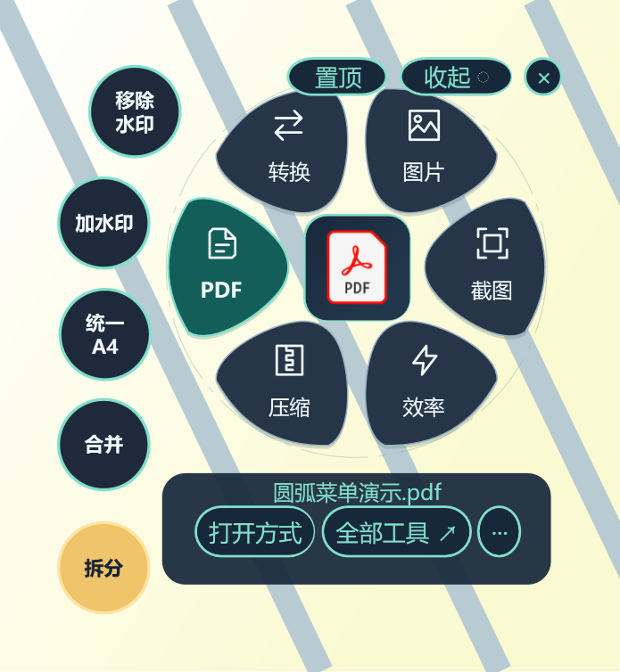
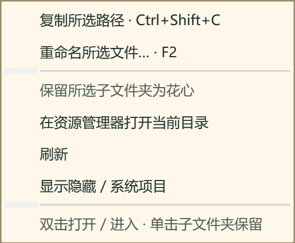

# 轻舟 LightOffice 0.8.0.1

2026-11-18 · 小更新 / Maintenance release

[下载最新版](https://github.com/mengqy2022/LightOffice-Public/releases/latest) · [安装升级](installation.md) · [验证范围](validation.md)

## 本次变化与操作方法

| 变化 | 如何使用 |
|---|---|
| 自动跟随与动画 | 连续选择文件时直接定位，避免重复位移动画；首次出现保留短淡入。遵循系统关闭动画设置，软件渲染/低渲染等级减少缩放动画。手动选择的动画样式继续保留。 |
| 紧凑圆弧 | 切到圆弧主题，分类中的圆形操作直径48 DIP、间距6 DIP；靠近花心紧凑排列。屏幕边缘向可用空间聚拢，避开标题与控制区，空间不足改为紧凑列表。悬停查看完整名称及不可用原因。DIP会按Windows缩放，不是固定物理像素。 |
| 重命名Enter | 名称不变也可按Enter关闭；修改后Enter执行改名并关闭，非法名称/冲突保持编辑。不同文件独立窗口，同一文件复用。 |
| 子文件操作 | 悬停收起文件夹，右键子项复制所选路径（Ctrl+Shift+C）；选中文件按F2或右键重命名。文件夹只支持复制路径。改名后重新浏览即可看到新名称，母文件夹花心保留。 |
| 收起并保留 | 只保留一个收起入口，点击「收起 ◌」或右键「收起并保留」；不再提供单独「多开 +」。当前目标收起后再选其他文件，已有花心继续保留。Ctrl+M当前、Ctrl+Shift+M全部；旧Ctrl+N兼容为收起。快捷键作用于花屿内，最多12个，同路径复用，会话结束不恢复。 |

独立工作台、母子文件夹浏览和主题组配色继续保留。基础包没有增加运行引擎或可选大型软件。

## 界面示例

| 紧凑圆弧操作 | 纸墨子文件菜单 |
|---|---|
|  |  |

以上由本次受保护程序的真实WPF控件离屏渲染，使用合成文件，不是物理鼠标桌面截图。圆弧图按显示缩放渲染，图片内像素不等于DIP。

## 下载与安装包管理

推荐下载 **LightOffice-0.8.0.1-Setup.exe**。便携ZIP是可选替代，无需同时下载。日常优化累积为一个正式版本；下载入口统一指向最新版，历史发行保留回退。

退出正在运行的轻舟后运行安装向导。识别Inno旧版后沿用目录及卸载身份，按SHA-256跳过相同文件，保留设置与可选组件。下载仍是完整离线包，不是差分下载。成功安装并确认运行正常后可删除下载的安装包，不要删除安装目录中的unins000.exe/dat。

当前程序与安装器没有受信代码签名，请核对官方Release附带SHA-256。源码和测试只同步到私有开发库。

## English

This maintenance release combines the recent local improvements into **one cumulative update**:

- Direct file-selection following avoids repeated motion; limited rendering hardware uses reduced animation and system animation preferences are respected.
- Circular actions are 48 DIP across with 6 DIP spacing, packed around the flower and toward usable space at screen edges. A compact list is used when needed. Tooltips retain full names and disabled reasons.
- Enter closes an unchanged rename editor. A valid changed name is renamed and the dialog closes; errors keep the editor open.
- In a collapsed folder preview, right-click or Ctrl+Shift+C copies the selected path. F2/context Rename opens the existing editor for a file. Folder renaming is not provided in this preview.
- One **Collapse and keep** entry replaces the separate multi-open button. Existing parent/child badges and independent workbenches remain. Ctrl+M toggles the current flower; Ctrl+Shift+M toggles all inside the flower UI. The old Ctrl+N action now collapses and keeps.

Download the installer for normal use; the portable ZIP is optional. You do not need both or every intermediate version. The latest-release page is the common download entry; previous releases remain available for fallback. Installation skips unchanged files but the download is a full package, not a differential updater. Exit LightOffice before upgrading. No new runtime engines are bundled. Both program and installer are unsigned; verify the official SHA-256 files.

Validation is scoped to the final protected executable and isolated installer tests described in [validation](validation.md). The UI images in older guides remain historical. This patch does not claim new physical mouse, sleep/resume, clean-machine or another-PC performance acceptance.
