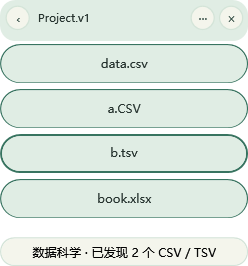
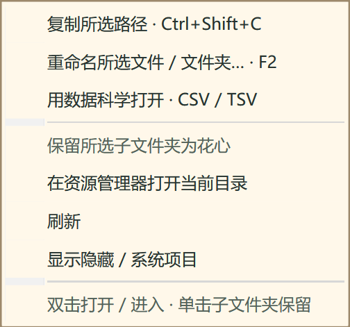

# 轻舟 LightOffice 0.8.0.2

2026-11-19 · 文件夹改名与数据科学快捷入口 / Maintenance update

[下载最新版](https://github.com/mengqy2022/LightOffice-Public/releases/latest) · [安装升级](installation.md) · [验证范围](validation.md)

## 文件夹也可以重命名

1. 悬停收起文件夹，选中子文件或子文件夹，按 **F2** 或右键 →「重命名所选文件 / 文件夹」。花心本身右键或花屿内F2也可改名。
2. 文件只编辑主名称并保留扩展名；**文件夹编辑完整名称**，例如 `Project.v1` 可以改成 `Project.v2`，不会自动追加 `.v1`。
3. Enter成功后关闭；名称未改也可Enter关闭。非法名称、重名或占用失败时保持编辑，不覆盖已有目标。磁盘根目录不能重命名。
4. 已保留的母子文件夹和内部文件花心同步到新路径，保留收起状态；组配色、打开方式历史及路径偏好一起迁移。旧任务日志属于历史，不改写成新路径。

文件夹重命名前，先完成处理任务，关闭其他工作台和相关改名窗口。工作台可能引用额外的输入/输出路径，仍打开时会提示等待，不强制关闭。权限和外部占用由Windows裁定。仅改名称，不递归处理内容；批量文件夹改名未加入。

## 从收起文件夹进入数据科学

悬停小花心约0.4秒打开列表。当前已加载项目包含CSV/TSV时，底部出现适配主题的小型数据科学按钮。

- 选中CSV/TSV，点击提示按钮，打开该数据文件。
- 未选中数据文件时，点击提示打开当前已加载列表中的首个CSV/TSV。
- 也可右键指定文件 → **用数据科学打开 · CSV / TSV**。
- 原文件夹花心继续保留；同一文件重复打开复用工作台。双击文件仍用Windows默认程序打开。
- 只检查已加载条目的扩展名，不递归扫描，不预读文件内容；更多分页/子目录需要继续浏览。隐藏文件遵循当前浏览设置。`.csv`结尾的文件夹不会误判成数据文件。

提示表示格式可尝试处理，内容是否有效由数据科学读取时验证。XLSX仍不支持，原文件只读，处理结果另存。

## 界面示例

| 经典 | 圆弧 | 纸墨 |
|---|---|---|
|  |  |  |

以上为本版受保护程序的真实WPF控件离屏渲染，使用合成文件，并非物理鼠标操作截图。示例中名为data.csv的一项是文件夹，不会触发数据科学入口。

## 安装与更新

只发布一个汇总小版本。推荐 **LightOffice-0.8.0.2-Setup.exe**；便携ZIP可选，无需同时下载。退出旧版后运行安装器，识别Inno旧版后原位更新并跳过相同文件，保留设置/历史/可选组件。完整离线下载，无差分下载。确认新版本正常后可以删除下载的安装包，保留安装目录中的卸载EXE/dat。没有新增运行引擎；程序和安装器仍未代码签名，请核对官方SHA-256。

## English

Folders can now be renamed from a collapsed-folder preview with **F2** or the context menu. Rename the whole folder name, including dots; file extensions remain preserved for files. Enter closes on success or when unchanged. Conflicts/invalid names keep the editor open; drive roots and overwriting existing targets are rejected. Retained parent/child/file badges, group colors and path preferences follow the new path. Finish processing tasks and close other workbenches or affected rename editors before renaming a folder. Historical task logs are preserved.

A compact, themed **Data science** suggestion appears when the preview's **currently loaded entries** include CSV/TSV files. Select a supported file and click the suggestion, or right-click that file and choose Data science. With no supported selection, the suggestion opens the first supported file in the loaded list. The parent badge stays collapsed; repeated opening of the same file reuses its workbench. Double-click keeps its usual Windows open behavior.

Detection checks extensions only, with no recursive scan or content preload. Continue paging/navigating to discover further entries. Folders named with a `.csv` suffix and XLSX files are not offered. Actual parsing still validates content. Originals remain read-only and results are saved separately.

This is one cumulative update with an optional portable alternative. No new runtime engine. Both program and installer remain unsigned; verify official SHA-256 assets. Validation is scoped in [validation](validation.md); no new physical mouse, sleep/resume, clean-machine or another-PC acceptance is claimed.
