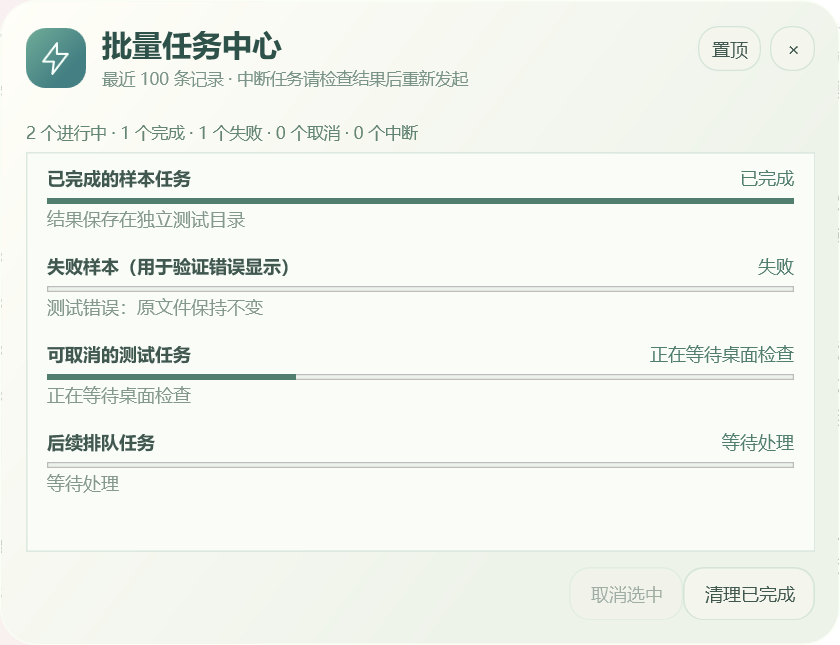
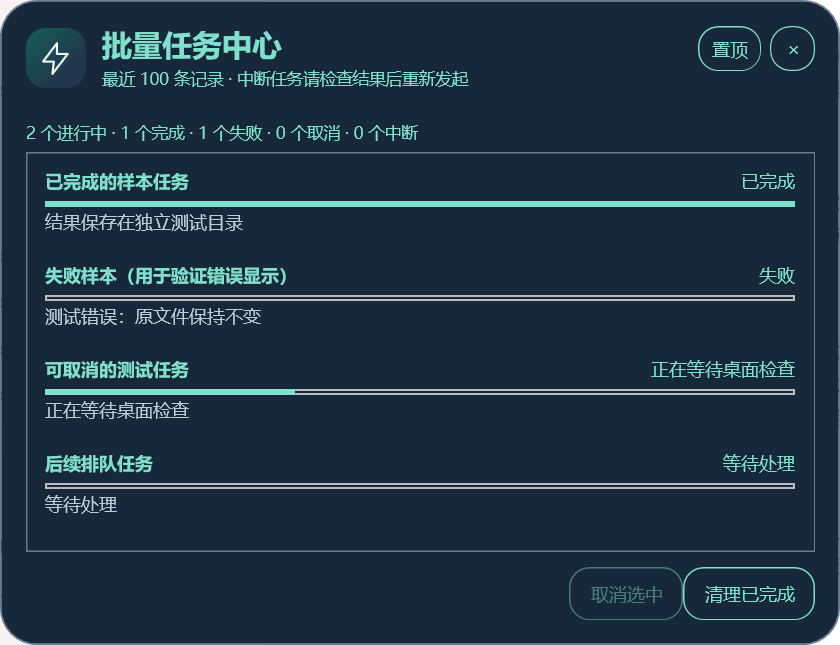
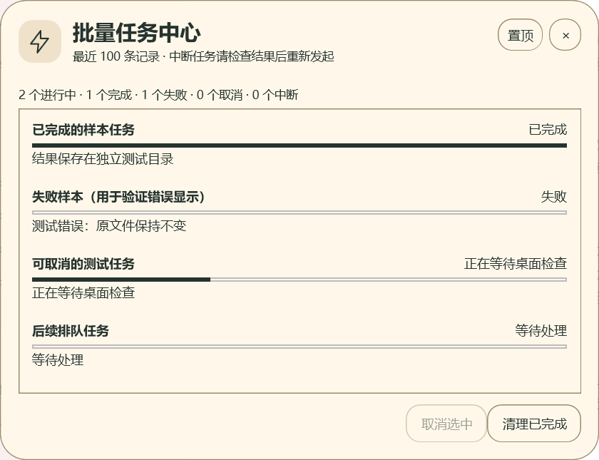

# Batch task center · 0.8.0.0

[简体中文](task-center.md) · [English overview](../README.en.md) · [Validation scope](validation.md)

The task center brings long operations into one place: queue state, progress or stage, results, errors and cancellation. It adds no database, background service, Python/R runtime or bundled processing engine. The application interface remains Simplified Chinese.

## Start a task

1. Right-click the LightOffice tray icon and choose **批量任务中心…** (Batch task center), or search for “任务” in the tool library. Relevant workbenches also provide an entry.
2. Start an image batch with a new output location. Open the task center to see its stage or actual progress.
3. Submit another operation. Heavy processing reuses the existing single worker; later tasks queue instead of competing for resources.
4. Select an unfinished task and choose **取消所选** (Cancel selected). Running work stops at supported cancellation points. Completed files remain; cancellation is not rollback.
5. Read the result or error before retrying. Operations without row-level progress report stages rather than an invented percentage.

## Supported workbenches

Image batches; batch rename and recovery; PDF split, merge and A4 normalization; archive creation and extraction; CSV/TSV sample loading, processing preview, full-file export and row append. This does not make every tool a background task. Optional office/compression engines retain their existing configuration.

## History, interruption and exit

Up to 100 recent task metadata records are saved locally beside user preferences. Names, times, summaries and errors may contain file information; redact them before sharing diagnostics.

Closing the task window leaves work running. Exiting the application is refused while tasks are active; wait or cancel first. Normal exit waits for history persistence.

**Restart restores metadata, not execution.** Previously running or queued jobs become **已中断** (Interrupted). They are never automatically replayed or resumed. Check existing outputs before submitting again. A forced termination or power loss may lose the most recent state that has not reached disk.

**清理已完成** (Clear completed) removes terminal history entries, preserving original files and outputs. Unreadable, future-version or unwritable history is preserved with a notice; do not assume unsaved records are durable.

## Appearance and limits

Drag the title, pin/unpin, resize or close the window. Classic, Circular and Paper palettes are supported. Long stages use ellipsis and tooltips. Hidden/minimized windows pause list refresh and catch up when shown.

| Classic | Circular | Paper |
|---|---|---|
|  |  |  |

Screenshots use synthetic tasks, including an intentional failure sample. They contain no user documents. CSV/TSV processing is record-based, but grouping/deduplication use bounded memory. There is no structured XLSX editor or promise of fast 500MB–2GB Excel imports. Updates remain full downloads; the installer skips unchanged files by hash.
