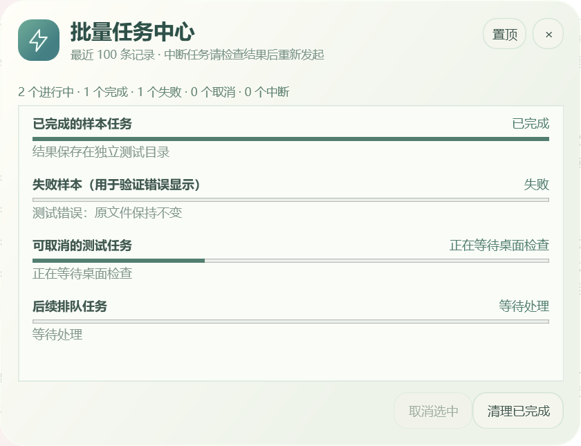
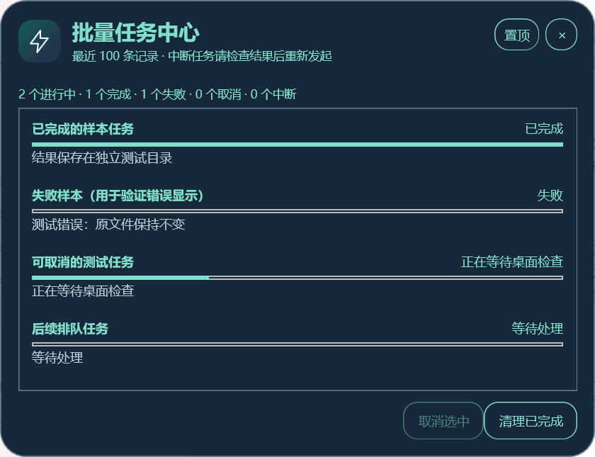
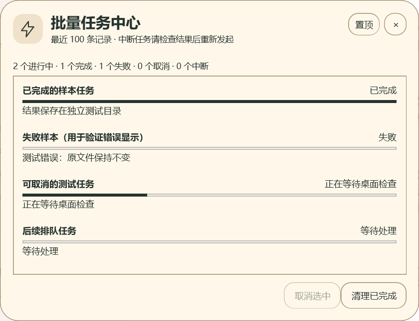

# 批量任务中心 · 0.8.0.0

[English](task-center.en.md) · [全部功能](catalog.md) · [验证范围](validation.md)

任务中心把较长的批处理操作集中到同一个窗口。可以查看等待顺序、当前阶段、结果和错误，也可以取消尚未完成的任务。基础包不增加数据库、服务、Python/R或大型运行引擎。

## 从哪里打开

右键系统托盘的轻舟图标，选择「批量任务中心…」；也可在「全部工具」中搜索“任务”。图片、批量改名、PDF、压缩与数据科学工作台中也有任务中心入口。

## 完成第一个任务

1. 选择一组图片，打开「图片批处理」，设定尺寸、格式和新的输出位置，然后开始。
2. 打开任务中心，查看任务名称、进度或阶段说明。没有真实行级进度的流程只显示阶段，不显示虚构百分比。
3. 再提交一个批处理任务：后续任务排队，重型处理复用单工作线程，减少同时争用内存。
4. 选中未完成任务，点击「取消所选」。排队任务无需等待前一任务结束；运行任务在支持的取消检查点停止。已经完成的文件保留，不自动撤销。
5. 完成后查看结果摘要。失败时保留错误说明；先检查结果和输出目录，再手动重试。

## 哪些操作会登记

| 工作台 | 操作 |
|---|---|
| 图片 | 批量尺寸、格式、水印处理 |
| 重命名 | 批量规则执行与恢复 |
| PDF | 拆分、合并、检查并统一A4 |
| 压缩 | 压缩、解压 |
| 数据科学 | CSV/TSV样本读取、处理预览、全文件另存、多文件按行追加 |

任务中心并不意味着每个按钮都变成可后台运行的任务。外部办公或压缩引擎仍按原有组件配置使用，不随基础包捆绑。

## 历史和退出

最近100条任务元数据保存在当前用户的轻舟配置目录。名称、时间、状态、摘要和错误也可能包含文件信息；它们保存在本机，反馈日志前请检查并脱敏。

关闭任务中心窗口不会取消后台操作。仍有活动任务时，退出轻舟会被阻止并显示任务中心；请等待或取消，再退出。正常退出会等待历史写入。

**程序重启后恢复的是历史记录，不是执行现场。** 上次排队或运行中的任务标记为「已中断」，不会自动重做或断点续跑。先检查已生成文件再重新发起，避免重复操作。强制结束进程和断电可能使最近一次尚未落盘的状态丢失。

「清理已完成」移除终态历史，不删除原文件或已生成输出。损坏、未知版本或写入失败的历史会保留并提示；不能把提示消失前的记录当成已经保存。

## 三种主题与窗口操作

任务中心支持拖动标题、置顶、关闭和调整窗口尺寸，随经典、圆弧、纸墨切换。长阶段文字截断显示，悬停查看完整内容。列表在隐藏或最小化时暂停界面刷新，恢复时补齐状态。

| 经典 | 圆弧 | 纸墨 |
|---|---|---|
|  |  |  |

图片使用合成任务，包含故意失败的样本以展示错误状态，不包含用户资料。

## 使用边界

CSV/TSV按记录读取，但去重、分组和图形抽样仍有内存预算；逐行读取不等于任意操作恒定内存。当前没有结构化XLSX编辑，也不承诺500MB–2GB Excel快速导入。当前更新仍下载完整安装包，安装时按哈希跳过相同文件。
