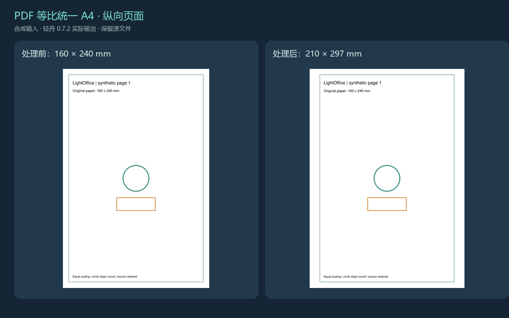
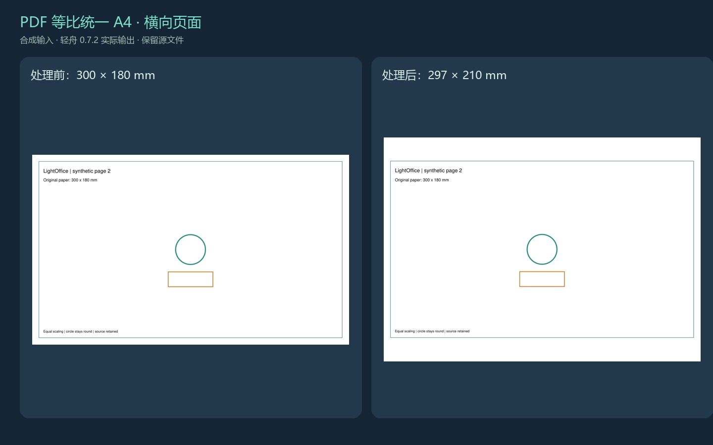
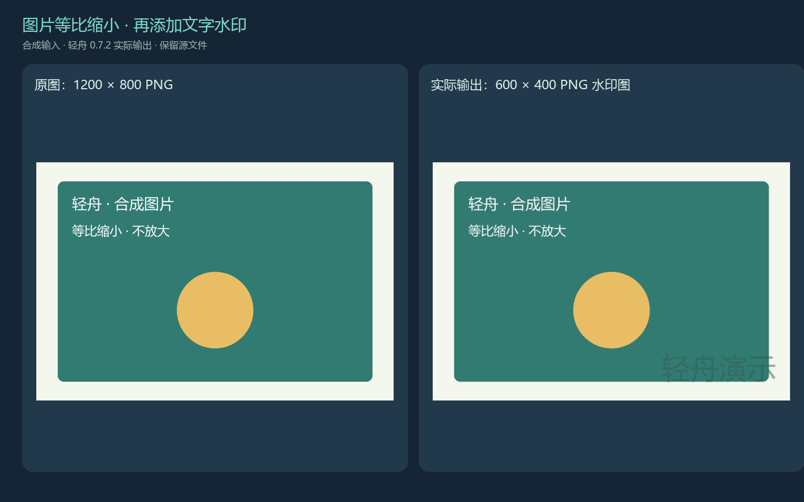
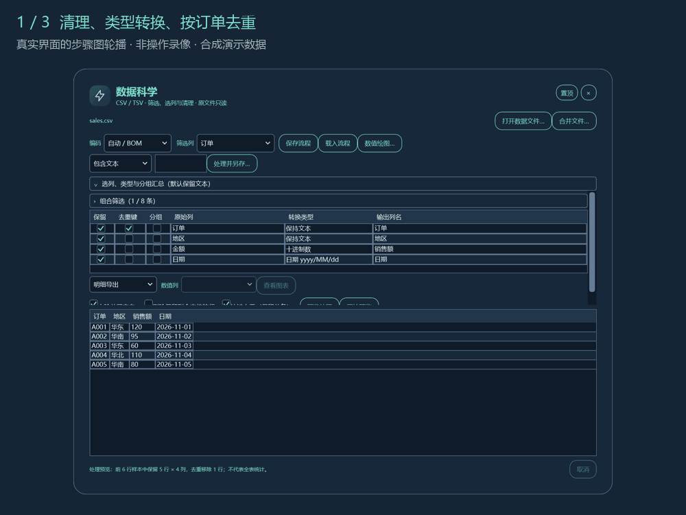
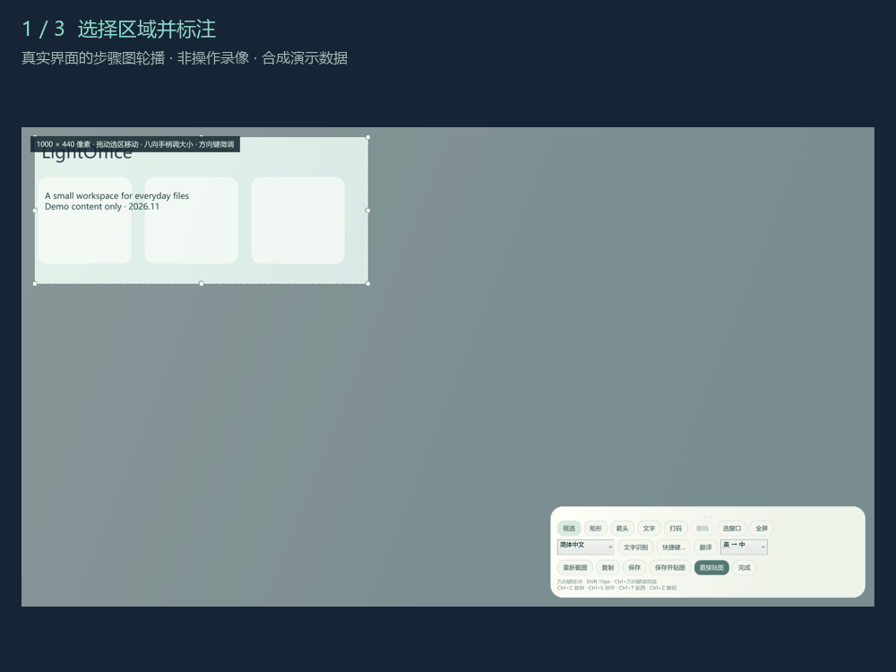
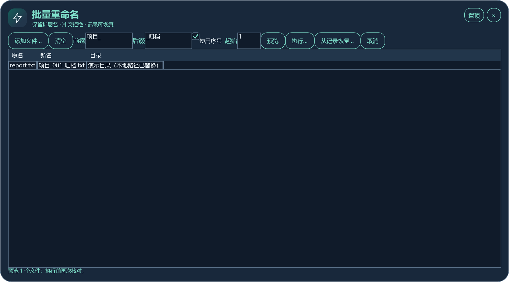
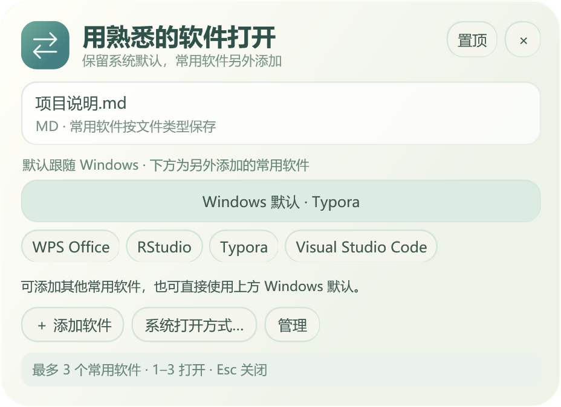
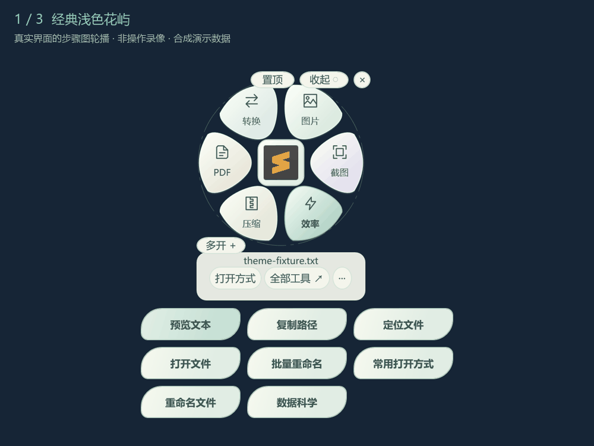

# 六个可以照做的任务

[三分钟上手](quickstart.md) · [下载全部示例](../examples/README.md) · [故障排查](troubleshooting.md)

以下能力在 0.6 已提供；深色界面和本次新增实际输出来自 0.7.2 候选，尚无正式候选下载。所有输入为合成文件。动图是已验证真实界面的步骤图轮播，**不是鼠标操作录像，也不是每帧都在执行任务**；每帧停留约 4 秒，静态步骤保留在正文。

## 扫描 PDF 统一 A4

目标：保持页面内容比例，分别适配横向 / 纵向 A4。示例 PDF 为合成矢量图，不是扫描件；演示的是相同的页面尺寸转换，不代表扫描件文字识别或清晰度增强。

1. 下载 [mixed-pages.pdf](../examples/pdf/mixed-pages.pdf)：三页分别为 160 × 240、300 × 180、210 × 297 mm。
2. 选中文件，在 PDF 分类点击「PDF 统一 A4」。检查结果应为 3 页，其中 2 页非 A4。
3. 查看提示，选择新的输出位置并执行。已有 A4 页保留，非 A4 页等比例缩放、居中并留白；横向页保持横向。
4. 用 PDF 阅读器查看输出页尺寸，再对照[实际导出 a4-pages.pdf](../examples/pdf/a4-pages.pdf)。应为 210 × 297、297 × 210、210 × 297 mm。
5. 图中的圆仍是圆，矩形比例保持。此次三个输出页面经独立引擎核对页尺寸、文字和 X/Y 缩放一致；复杂文档仍需检查。

加密、签名、交互表单或非 A4 页带批注 / 链接时可能拒绝处理。保留源文件，提示不支持时先通过可信 PDF 工具另存静态副本，再检查处理结果。更多边界见[PDF 专题](components.md#pdfa4顺序水印)。

## 图片等比缩小与水印

目标：三张不同尺寸的图片统一为最长边 600 px；小图不放大，再单独给结果加文字水印。

1. 下载 [横图 1200 × 800](../examples/images/landscape.png)、[竖图 800 × 1200](../examples/images/portrait.png)、[小图 320 × 240](../examples/images/small.png)。
2. 在「图片批处理」添加三张图，输出选 JPG，最长边 600，质量 90，选择单独的输出目录。
3. 点击「开始处理」。结果分别应为 600 × 400、400 × 600、320 × 240 px；原始图保留。
4. 下载实际结果核对：[横图](../examples/images/landscape_batch.jpg)、[竖图](../examples/images/portrait_batch.jpg)、[小图](../examples/images/small_batch.jpg)。文件体积会受内容和编码器影响，不承诺固定压缩比例。
5. 选中横图结果，进入文字水印，填「轻舟演示」，右下角、透明度 50%、字号比例 8%，另存 PNG。对照[实际水印图](../examples/images/landscape-watermark.png)。

图片批处理与文字水印是两次独立操作。PNG 可保留透明；JPG / BMP 透明区域填白，批处理不保留 EXIF 等元数据。窗口中的「查看结果」可定位输出；部分失败时已完成图片仍会保留。

## 数据清理与绘图

目标：6 条记录按订单去重为 5 条，统一日期，再按地区求和并导出折线图。

1. 下载 [sales.csv](../examples/sales.csv)，在数据科学中打开。
2. 「金额」改为十进制数，输出列名改为「销售额」；「日期」选择 `日期 yyyy/MM/dd`。
3. 勾选「订单」去重键并开启按键去重，预览 5 条，另存后对照 [cleaned.csv](../examples/cleaned.csv)。
4. 如果需要条件筛选，下载并载入 [east-over-100.json](../examples/east-over-100.json)：地区华东且金额 ≥ 100，结果只有 A001。载入前应重新打开原始 CSV，列名与顺序必须匹配。
5. 为汇总重新打开原始 CSV，按订单去重、勾选地区分组，选分组求和与金额数值列，再执行全文件另存。对照 [region-totals.csv](../examples/region-totals.csv)：华东 180、华南 175、华北 110。
6. 另存成功后「查看图表」，选择分类折线并另存 PNG。对照[实际图表](../examples/region-line.png)。分类顺序不代表时间，直方图 / 散点图采用有限抽样。

流程 JSON 可复用，源 CSV 不自动嵌入其中。更多条件、类型与预算见[数据科学专题](data-science.md)。

## 截图识别与翻译

目标：只识别需要的区域，修正原文后在软件内翻译。

1. 准备不含私人信息的清晰中英文图片，用 `Ctrl+Alt+S` 截图，框选文字区域；可用方向键微调。
2. 按需添加箭头或矩形；识别正文时尽量避免标注遮住文字。选择正确的 OCR 语言，点击「文字识别」。
3. 检查并修正原文中的错字和换行。OCR 在本机运行，需要相应 Windows OCR 语言能力。
4. 选择「英 → 中」或「中 → 英」，主动点击「翻译」。文字发往所选网络服务，原文与译文直接显示在轻舟中。
5. 复制译文，或保存 / 直接贴图。需要保留未保存的贴图时，请在关闭前另存。

动图沿用历史合成界面，不代表本轮重新请求了翻译服务。0.7 候选可配置 LibreTranslate；示例域名不能直接使用，详见[服务配置与隐私](capture.md#gui-内翻译与服务设置)。

## 批量改名并恢复

目标：先预览，再给两份测试副本编号，最后从恢复记录还原名称。

1. 在自己新建的测试文件夹创建 `report.txt`、`notes.txt`，写入任意非敏感测试文字。
2. 打开批量重命名，按上述顺序添加两份文件，设前缀 `项目_`、后缀 `_归档`，启用序号，起始 1。
3. 点「预览」，确认目标为 `项目_001_归档.txt`、`项目_002_归档.txt`；若添加顺序不同，编号会不同。
4. 执行时保存恢复记录。文件名会真实改变，扩展名保留，文件内容不变。
5. 点击「从记录恢复…」，选择刚生成的记录。内容哈希和原名称占用通过后恢复原名。对照[本次真实执行结果](../examples/rename-result.csv)。

不要下载别人的恢复记录来操作自己的文件：记录包含机器上的完整路径。这里只分享不含路径的结果 CSV；本次测试确实执行并恢复了合成文件。发生部分失败时保留记录、查看当前名称，避免反复盲目执行。

## 系统默认与常用打开方式

目标：保留 Windows 默认程序，同时增加一个常用打开选项。

1. 先确认该类型文件在 Windows 中当前默认使用的软件。
2. 在轻舟「常用打开方式」检查「Windows 默认」与系统推荐；选择默认入口应继续交给系统处理。
3. 点击添加，选择自己已安装软件的 EXE。它作为额外常用项出现，原 Windows 默认入口保留，最多三个自定义程序。
4. 仅想临时打开时，直接点击对应软件。需要轻舟内优先时，再明确设置「轻舟内优先」；恢复可选择「跟随 Windows」。
5. 需要追加到系统候选时使用「加入系统推荐」。这不会改 UserChoice 或系统默认；原生菜单顺序和刷新由 Windows 决定。

各机器安装的软件不同，本教程不提供虚构的统一软件列表。遇到不同步先看[打开方式排查](troubleshooting.md#打开方式没有立即对齐)。

## 主题切换预览

候选 0.7.2：经典浅色与圆弧高对比主题可选，工作台同步换色，参数保留。以下是三个真实视图轮播，不是连续录屏；正式 0.6 下载暂不包含该选项。

